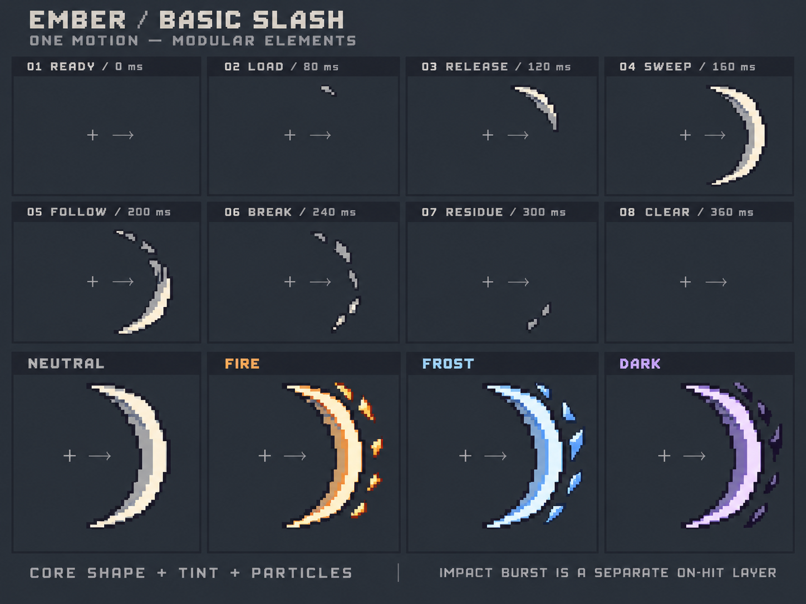

# 初始近战挥击：关键帧设计 v1

此版已被用户指出力量感不足，保留作历史比较。当前制作方向见[v2力量感修订](../basic-slash-v2/README.md)，不要继续以本版的细斩弧为生产目标。

2026-10-21。用户希望初始普通近战攻击共用一个基础效果，通过粒子和颜色表现火、冰、黑暗等变化。本次为概念设计交付，尚未替换运行时特效或实现新粒子系统。

上两行是一次朝右挥击的8个关键状态；下行比较同一基础弧的4种配色与粒子提案。1 / 8格没有效果，十字和箭头只是设计辅助线。图中时刻为当前普通挥砍0.12秒前摇 / 0.12秒有效期的参考；实际高攻速读取模拟给出的相位。

- [设计规格、时序、分层与接入边界](../../docs/design/BASIC_MELEE_VFX.md)
- [实际生成Prompt](concept.prompt.txt)
- [输出尺寸与来源哈希](generation.json)

使用内置image_gen，以已选粗像素Q版概念作像素密度参考。原始输出原样保存；图中背景、标题、十字和箭头不属于运行时贴图。静态检查确认起止为空、挥击方向一致、弧内留空、四种元素共用形态。图稿有部分渐变与微小边缘混色，弧厚度是放大的概念示意；未声明严格限色 / 网格、透明生产图集、准确命中边界或动画播放已验收。

方案当前为设计提案，具体表现尚待用户反馈。后续生产独立灰度基础弧、粒子与命中资源，按真实攻击范围和战斗尺寸验收，不能直接切本设计板用于游戏。
