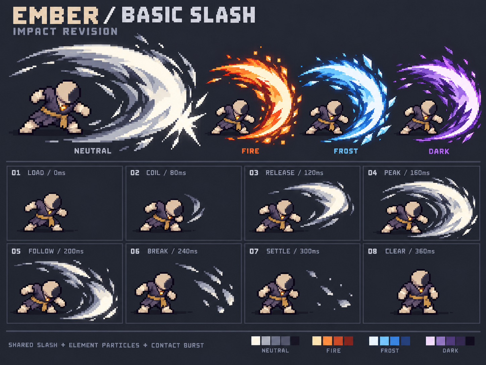

# 初始近战挥击 v2：厚斩面与力量感

用户后续指出本版边缘毛刺、外围粒子过多。当前清晰轮廓方向见[v3修订](../basic-slash-v3/README.md)；本版保留作历史比较，不再作为边缘与碎片的生产目标。

2026-10-21。用户指出v1力量感不足，提供宽大弧形斩击与白橙爆发参考。本版使用内置image_gen重新生成设计板：增加主斩面的厚度、前厚后尖的变化、两道错位残影与独立命中爆点，保留粗像素风和元素共用基础动画的方案。当前是修订设计提案，没有替换游戏资源。

上方以同一Q版人物比较中性 / 火 / 冰 / 黑暗效果，左侧主图额外示意命中爆点；下方8格是一次空挥的关键状态，因此没有命中爆点。顶部中性主图被放大用于观察形体，并非四种攻击具有不同射程。人物仅作尺度与动作意图示意，不是新的角色动画图集。

- [形体、相位、分层与打击反馈规格](../../docs/design/BASIC_MELEE_VFX.md)
- [实际生成Prompt](concept.prompt.txt)
- [来源、尺寸与哈希](generation.json)
- [静态检查与未验收项](validation.json)

生成参考包括用户的两张力度参考（保存在references/）及[已选粗像素主角](../rekindled-chibi-v2/concept.png)。用户图片只用于斩击厚度、运动与爆发参考，不复制角色、符文、环绕范围或水印。输出原样保存，没有程序重绘、缩放或像素化处理。

本次静态检查确认：宽斩面与分层残影、四种元素方案、8格关键状态、首尾无斩弧、主体身份连续。图中的弧度、尺度与锚点仍是示意；元素比较也未做到逐像素共用一张底图。第02格起锋应进一步缩短变暗，第06/07格残片在生产时降低亮度。局部边缘仍有混色，不能宣称严格网格与限色通过。

后续需制作独立透明基础弧、粒子、命中爆点，并对照模拟的117°扇区、实际半径与相位完成生产和播放。图板包含人物、背景、标题，不可直接切成运行素材。动作停姿、受击、音效与多人性能均尚未验收；新的具体风格细节没有被记录为用户已批准。
