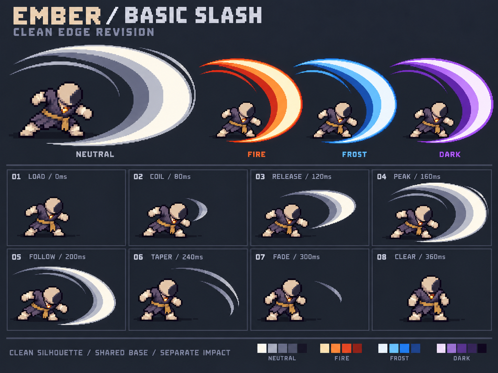

# 初始近战挥击 v3：清晰边缘

用户随后否定本版内部过于简单的色带；当前制作方向见[v4移动亮锋与透明拖尾](../basic-slash-v4/README.md)。清晰外轮廓要求保留，但不能再将整条弧画成均匀不透明的平行色带。

2026-10-21。用户指出v2边缘锯齿过多、外围粒子明显，要求参考原图清晰连续的特效轮廓。本版使用内置image_gen编辑v2设计板，保留宽厚斩面、人物身份、四种配色和8个关键状态，清理毛刺与外围碎屑。

主斩面改成连续的弧形曲面，内部以宽色带分层；拖尾收成完整、轮廓明确的条带。收尾改为条带缩短淡出，不碎成散点。四种元素仅展示基础弧染色，命中爆点和可选粒子暂不画入这张板，之后独立制作。顶部中性图放大用于观察，不代表四种配色射程不同。

- [制作规格](../../docs/design/BASIC_MELEE_VFX.md)
- [实际编辑Prompt](concept.prompt.txt)
- [生成来源与哈希](generation.json)
- [静态检查](validation.json)

编辑目标为[v2设计板](../basic-slash-v2/concept.png)，辅助参考沿用用户的[宽斩面](../basic-slash-v2/references/broad-sweep.png)与[冲击轮廓](../basic-slash-v2/references/impact-silhouette.png)。输出原样保存，未程序重绘或模糊。

静态检查：主弧外侧不再散布独立粒子，内外轮廓连续，三种元素保留厚斩面；首尾无刀光，收尾变为完整细带。正常显示清晰不等于严格像素网格、二值alpha或实际战斗尺寸已验收；当前仍为带背景和文字的概念板，不能直接切成运行图集。前摇与余迹在生产时还需降低亮度，角度 / 锚点 / 射程以模拟为准。没有改游戏代码或替换运行资源，尚未验收动态打击感。
