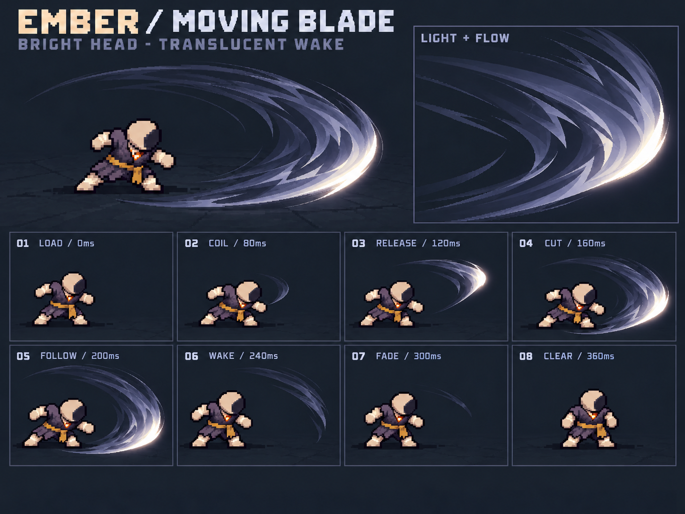

# 初始近战挥击 v4：移动亮锋与透明拖尾

用户后续指出本版仍是中间粗、末端细。粗细关系以[v5当前端最粗](../basic-slash-v5/README.md)为准；本版内部光流、明暗与透明层次继续作为制作参考，不能照搬两头尖的月牙轮廓。

2026-10-21。用户否定v3过于简单的内部色带，要求参考哈迪斯式挥击：“武器所在位置最亮，甩出拖尾，拖尾逐渐变透明、变暗”。本轮重新设计中性基础挥击，先集中解决光流、透明层次与移动亮锋，不继续批量画元素换色。

上方为整体效果与内部光流放大图，下方为8个时刻。亮锋从右上经过右侧到右下，旧轨迹沿挥动路径逐渐降低亮度和不透明度；内部使用长短不同的顺向细流、叠层薄面和透明通道，外轮廓保持干净，不在外围撒粒子。角色只是动作与比例示意；亮锋代表当前挥击刃口，不新增装备换皮或身体部件。

使用内置image_gen完成两步：先重做内部结构，再收紧白亮区域，避免旧尾迹仍有整段高亮描边。最终图为concept.png；pass1.png是编辑来源，保留供追溯。

- [当前制作规格](../../docs/design/BASIC_MELEE_VFX.md)
- [重设计Prompt](concept.prompt.txt)、[亮区修订Prompt](refine.prompt.txt)
- [生成来源及哈希](generation.json)、[静态检查](validation.json)

第一步参考[v3图板](../basic-slash-v3/concept.png)中的人物 / 构图，以及用户的[斩击参考](../basic-slash-v2/references/broad-sweep.png)。哈迪斯用于用户指定的表现方向，本轮未提取其游戏素材或将其资源接入项目。两次工具输出均原样保存，无程序重绘、模糊或量化。

这是一张不透明背景的概念板，图内“透出地面”是合成示意，不是已经可用的RGBA透明图集。明暗与透明度沿轨迹的变化是生产目标，不能靠给旧尾巴涂深色冒充。主体外缘仍有细小栅格阶梯与局部辉光，严格源网格、透明边缘及实际尺寸需生产验证；白亮区的角度、动作与相位也需要实机校准。未改运行资源，未验收动态打击感、真实命中、联机或性能，不将新稿记录为用户已批准。
