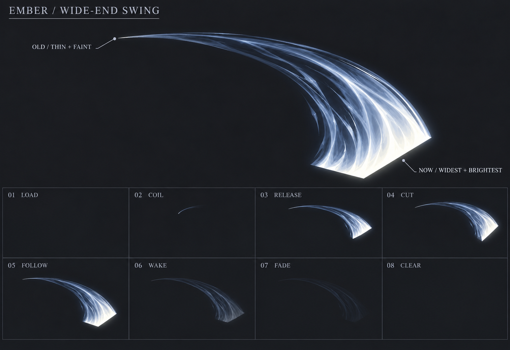

# 初始近战挥击 v5：当前末端最粗

用户进一步圈出参考中的斜圆钝高亮斩头，要求直接匹配；本版板状平切面不再作为头型目标。当前见[v6参考匹配](../basic-slash-v6/README.md)，粗端到细尾的关系保留。

2026-10-21。用户指出v4仍是中间粗、末端细，要求当前挥击到达的位置最粗，往旧轨迹方向才变细。本轮专门修正粗细分布，保留v4的内部光流与明暗 / 透明衰减要求。

为避免“前端 / 末尾 / 拖尾”混淆，统一表述为：

- **当前端**：挥击现在到达的位置，最粗、最亮，内外缘保持距离，形成宽斩切面。
- **历史轨迹**：离当前位置越远，越细、越暗、越透明。
- **最旧端**：唯一收尖的位置。不能在当前宽端之后再接一截细尖，不能画成中间鼓起、两头尖的月牙。

使用内置image_gen进行了两次制作。第一次沿v4编辑仍有明显月牙轮廓，保存为rejected-pass.png，不作为生产目标；第二次从空白重做独立形体，得到当前concept.png。输出均原样保存，未程序绘制或加工。

- [制作规格](../../docs/design/BASIC_MELEE_VFX.md)
- [首次编辑Prompt](revision.prompt.txt)、[独立形体Prompt](shape.prompt.txt)
- [生成记录](generation.json)、[静态检查](validation.json)

本图优先验证粗细关系：当前端有明确的宽斜切面，旧端收细。没有合成人物；下方状态图仍是概念示意，没有验证相位角度、共同锚点或连续运动。形体图的光流较平滑，不能替代项目像素密度、严格网格与透明素材验收；生产仍需沿用清晰像素方向，保留v4内部层次和移动亮锋。本图为不透明背景合成，真实alpha、动态打击感、Cocos接入均未验证。新稿不表示用户已批准。
