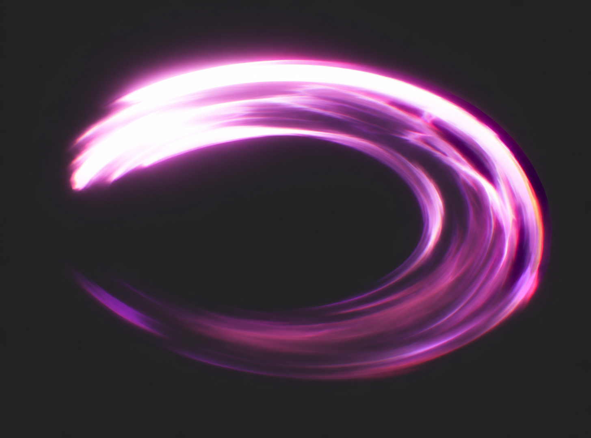

# 初始近战挥击 v6：直接匹配圈选斩头

用户已基本认可此方向，并要求基础效果改为白色、画出挥动关键帧。当前交付见[v7中性白与12状态](../basic-slash-v7/README.md)；本版粉紫仅保留为历史参考。

用户明确要求直接参考圈选部分，不再把斩头画成尖月牙或v5的板状平切面。本轮用内置image_gen，以本轮带红圈的附件为唯一图像参考，制作一张独立效果匹配图。

重点是左上 / 左侧宽厚、斜圆钝的高亮斩头，亮芯在这里占有实际面积；稍错开的发光薄面接入右侧弧形拖尾，再向旧轨迹降低亮度。为了方便比较保留参考的粉紫发光色，本次不将其定为游戏默认元素颜色。

- [生成Prompt](concept.prompt.txt)、[输出与来源记录](generation.json)
- [当前设计规格](../../docs/design/BASIC_MELEE_VFX.md)

带圈附件由会话最近图像输入（num_last_images_to_include=1），没有提供本地路径；其未标注底图已保存在[早期用户参考](../basic-slash-v2/references/broad-sweep.png)。原始生成输出原样保存，未程序加工。

此轮优先匹配用户指定头型与视觉位置，未重新制作八帧板。图仍为平滑的参考匹配稿，存在较长的亮弧与辉光，尚未完成像素化、真实alpha或动态 / Cocos验收。其环绕构图也不代表实际攻击范围扩大；生产保留117°世界扇区约束。新稿不记录为用户已批准。
