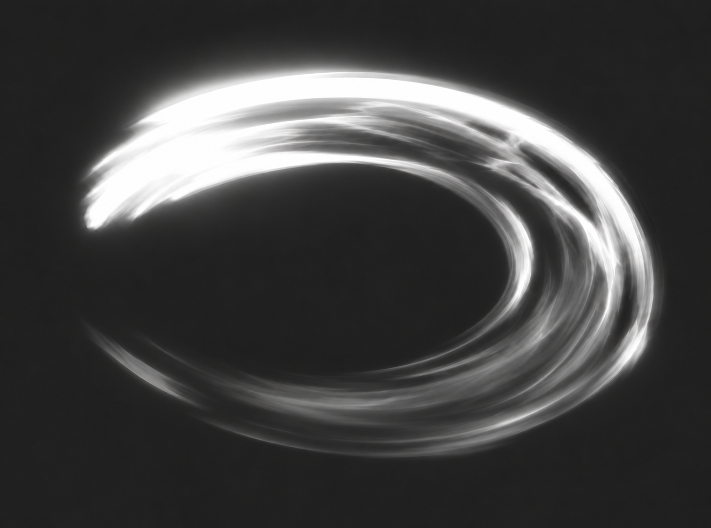
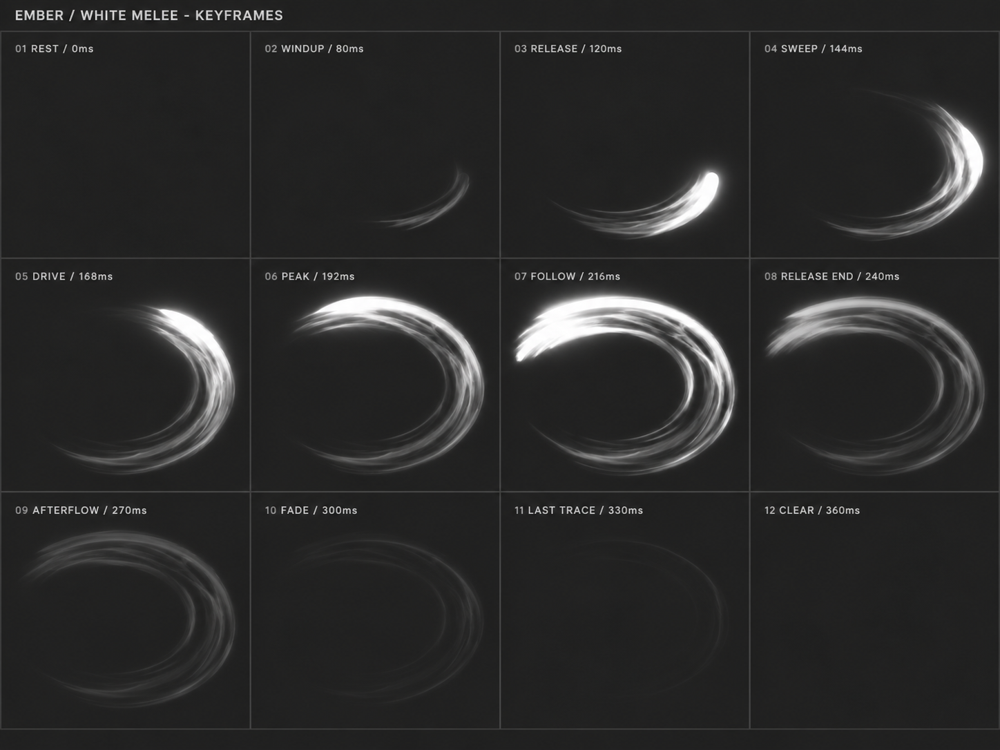

# 初始近战挥击 v7：中性白与12个关键状态

用户随后已选择此方案方向。生产采用一套标准朝向图集，按鼠标攻击方向连续旋转，具体支点 / 投影 / 拖尾契约见[任意方向制作要求](../../docs/design/BASIC_MELEE_VFX.md#任意方向一套图集连续旋转)。这不代表图板已成为可导入的生产动画。

当前已接入[原稿帧序版本 v3](../basic-slash-runtime-v3/README.md)：本目录原图不变，运行副本按固定窗口采样，材质去黑底并在关键时刻之间对齐亮锋混合。曾采用的曲线几何 v1 和弯曲纹理 v2 均被用户否定，已经停用。

后续用户明确选择“按定稿环扫，并同步修改判定”。当前按亮锋世界轮廓扫掠命中，旧扇区全域判定已移除，内部空洞与暗尾迹不伤害；[攻击 / 技能判定一致性规则](../../docs/PIXEL_VFX.md#攻击与技能特效的判定一致性)仍适用。制作窗口、共同原点、世界轮廓与运行验证见 v3 记录。

2026-10-21。用户基本认可v6的参考匹配方向，明确基础效果应为白色，并要求画出挥动过程。本轮保留宽厚斜圆钝斩头与交叠光流，去除粉紫色，交付中性整体图和12状态设计板。

设计板按从左到右、从上到下阅读：

| 状态 | 参考时刻 | 表现 |
| --- | --- | --- |
| 01 / 02 | 0 / 80 ms | 无效果、极弱起手痕迹 |
| 03 / 04 / 05 / 06 / 07 | 120 / 144 / 168 / 192 / 216 ms | 亮而厚的斩头从右下经过右侧、右上与上方，至左上；旧轨迹逐渐细、暗、透 |
| 08 | 240 ms | 停止产生新亮锋，留下灰色余迹 |
| 09 / 10 / 11 | 270 / 300 / 330 ms | 余迹逐步减弱 |
| 12 | 360 ms | 清空 |

这些是非均匀关键时刻，不能按12格固定FPS播放。当前默认前摇0.12秒 / 有效期0.12秒；高攻速仍使用实际模拟相位。本次经用户确认改为定稿环扫，基础射程保持5，实际命中按当前亮锋轮廓而不是整圈尾迹结算。

使用内置image_gen先制作[白色版本Prompt](white.prompt.txt)，再以实际白色输出制作[关键帧Prompt](keyframes.prompt.txt)。两份输出原样保存，无程序调色、裁切或重绘。[生成记录](generation.json)、[静态检查](validation.json)、[设计规格](../../docs/design/BASIC_MELEE_VFX.md)。

静态可见五个不同的出手位置、首尾空状态和后续消散。中间姿势的头型一致性、尾迹亮度及局部半径仍需生产精修；不能声称严格锚点对齐或连续动画已通过。本轮为RGB背景概念图，平滑辉光尚未转成项目最终像素素材，真实alpha / 动态打击感 / Cocos / 多人性能未验证。用户已选择整体设计方向，生产中的逐帧一致性仍由实际验收确认。
