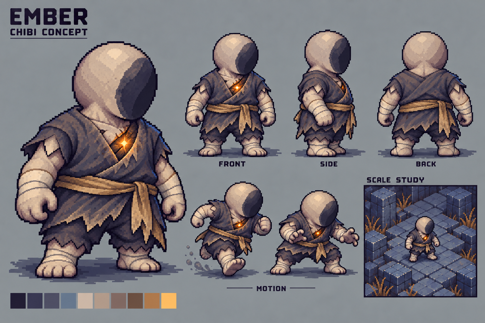

# Q版复燃者：已选体型与风格

后续要求：用户希望更粗的像素表现，最新[像素密度修订](../rekindled-chibi-v2/README.md)保留本图身份与比例，简化纹理和衣褶。本图不再作为细节密度目标。

2026-10-20。用户希望参考糖豆人的矮胖、圆润体型，先制作符合余烬主题的风格设计图。2026-10-21用户确认采用此Q版方向；本批次仍是概念设计，完整Q版动画尚待生产，未替换运行时人物。多人采用[共享图集材质换色](../../docs/HERO_COLORS.md)，不为每种颜色单独生成动画。

## 设计取向

- 保留像素表现，以大圆头、宽短躯干、短粗四肢与低重心形成矮胖轮廓；通过整身姿势表达性格。
- 延续无血、无发、无五官的复燃死者身份：灰白尸肤、阴影面部、暗灰紫裹衣、旧赭色腰带与局部小余火。
- 形象不绑定职业，装备不改变身体贴图；头、躯干和四肢保持完整相连。
- 设计板包含主视图、不同角度、跑动与蓄势姿态、小尺寸场景示意。正面标注的实际姿态偏三分之四，不能用作严格正交转面图；两张动作姿态不是动画循环，场景示意不是游戏截图。

## 来源与检查

- 工具：内置 image_gen；输出原样复制，未重绘、裁切或调色。
- 身份与材质参考：[主角03](../rekindled-hero-v3/concept.png)，只继承身份和配色，本次重新探索身体比例。
- [实际提示词](concept.prompt.txt)；[文件来源与校验](generation.json)。
- 已目视检查主角无血、无发、无五官，多个角度的衣物与余火身份一致，身体相连且轮廓完整。图像是像素风概念表现，尚未验证生产用像素网格、色板、alpha、帧间稳定性或多人实机可读性。
- 后续若采用此体型，需要独立制作完整动作、统一画布及地面锚点；不能将概念图切割拼成角色，也不能把图片的小场景当作地图坐标或碰撞依据。

本批次不涉及 Cocos 资源导入、游戏代码或构建，不记录为运行时完成。
