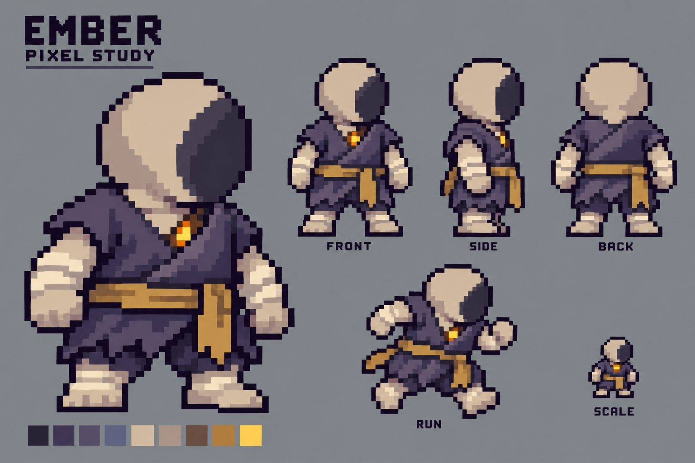

# Q版复燃者：粗像素修订

2026-10-21。按用户“再像素一些，现在还是太清晰了”的要求，保留[已选Q版形象](../rekindled-chibi-v1/README.md)，降低表现细节密度。

## 本次调整

- 改用更大的阶梯轮廓和整块明暗，明显减少头皮、衣褶和裹布纹理；手脚简化成完整块面。
- 保留大圆头、矮胖躯干、短粗四肢、无血无发无五官与胸口小余火。
- 衣料使用冷灰紫主色，仍按[共享图集配色契约](../../docs/HERO_COLORS.md)生产；阴影脸与可染色衣料必须在最终素材中区分。
- 交付包含主视图、不同角度、一张跑步姿态与小尺寸示意。图中FRONT仍偏三分之四视角，RUN只是一张关键姿，不是完整循环。

## 制作与验收层级

使用内置image_gen编辑，参考v1形象；[完整Prompt](concept.prompt.txt)、[原始输出与校验](generation.json)随图保存。PNG是工具原始输出，未使用程序缩小、量化或像素滤镜。

已目视对比v1，确认纹理密度明显下降、像素块和轮廓阶梯更大，完整身体和身份保留。Prompt中的48×64逻辑画布及16–20色是表达目标；返回的是概念板，不能据此宣称已经严格对齐逻辑网格或达到生产限色。阴影脸仍带少量冷色，正式贴图需要用中性深灰与专用衣料色阶分开，再实测换色。

此图本身是风格修订板。用户随后回复“ok，不错。开发下”，确认该方向并授权制作；完整Q版运行图集与动画接入见[ART-12生产记录](../chibi-runtime-v1/README.md)。
