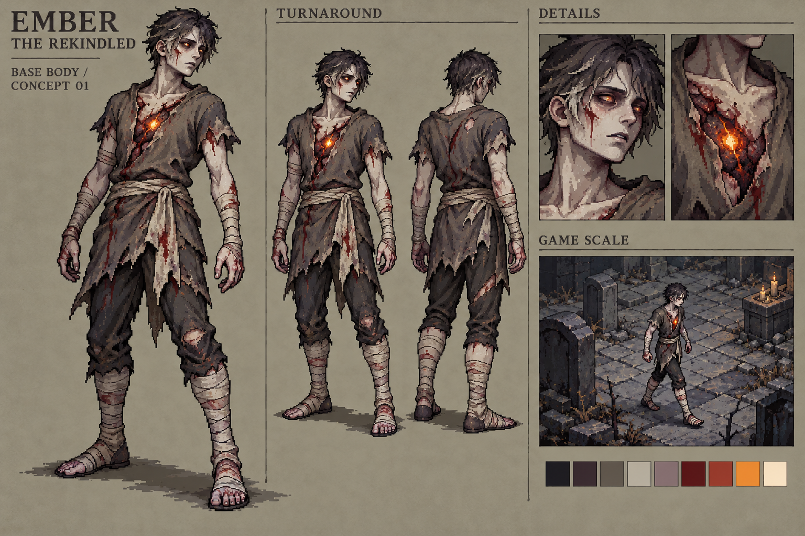

# 复燃主角 · 第一版形象候选

> 此为历史候选。用户后续选择死亡细胞取向，并要求无血、无发、无五官；当前身份及八方向动作见 [主角03](../rekindled-hero-v3/README.md)，不要恢复本图中的发型、面部或染血衣物。

2026-10-20，基线 `8a54f4c`。本轮交付世界观、美术方向与一张主角概念板，未制作动画图集或替换运行时资源。用户已确定保留像素风；**具体人物造型仍是候选，尚未定稿**。

## 图稿与来源

- [概念原图](concept-01.png)：1536 × 1024 PNG，原样保存内置 `image_gen` 的输出。
- [实际生成提示词](prompt.txt)：本次使用的完整提示词；没有以旧明亮遗迹图作为图像参考。
- [检查记录](validation.json)：文件尺寸、哈希、原图一致性与概念审阅结论。
- [世界观](../../docs/WORLD_LORE.md)：已确认故事及尚未确定的背景。
- [美术方向](../../docs/ART_DIRECTION.md)：当前风格、色彩、亮度与后续生产约束。

工具未返回可复用的模型版本或种子，不作虚构记录。原图约 2.4 MiB，保存在仓库的概念目录，不进入 Cocos 资源导入或图集注册。

## 这版设计的选择

共同身份是残火唤醒的死者，画面中的 “The Rekindled / 复燃者” 仅为工作称呼。设计采用苍白尸肤、疲惫眼神、焦黑短发、染血破衣与裹布，胸口残火和微亮眼睛作为集中识别点。暖色占比小，使死亡和余火共存；不通过整幅压黑表达世界观。

服装没有盔甲、法师袍、弓箭或职业徽记，保留后续装备表达流派的空间。本图采用的脸型、成年体态、伤口形状、发型和胸口火光都是可调整提案，不代表玩家只能使用这一性别或长相。角色与古代盗火英雄不是同一个身份。

概念板包含完整主形象、前 / 后三分之四视图、脸部与胸口细节，以及墓地环境中的尺度示意。墓地不是已确定的出生地图；右下角小图由同一次生成绘制，**不是游戏运行截图**。

## 审阅与下一阶段边界

已查看原图：轮廓、身体与残火有明确区分，衣着未绑定职业，人物在中明度地面上可辨。正 / 背视图能够支持形象讨论，但不是严格正交三视图。

生产前需处理：

- 衣物毛边、头发碎线、表面纹理和血迹仍偏密；实际战斗尺寸应合并成更大的像素簇，减少持续闪烁的小细节。
- 当前接近成年长身比例，尚未锁定游戏内头身比、源像素画布或显示倍率。不能把 1536 × 1024 的概念板当作严格限色精灵图。
- 面部仍偏完整、发型较整齐；若需要更强的死尸感，可以从眼窝、嘴唇、肤色和姿态继续调整，而不是仅增加伤口数量。
- 尚未拆分纸娃娃、测量肩 / 手 / 脚锚点或适配六格装备的三类外观；旧装备比例和挂点不能直接证明兼容。
- 未生成待机、行走、挥砍、施法、受击或死亡序列。后续丰富动作应依靠重心、肩胯对转、准备与回收关键姿，再处理布料和余火跟随。

本轮验证只覆盖概念文件、文档引用和 skill 结构。实际像素网格、共享色板、alpha、逐帧一致性、混搭和 Cocos 画面验证留给生产与接入任务，未将其标记为通过。
