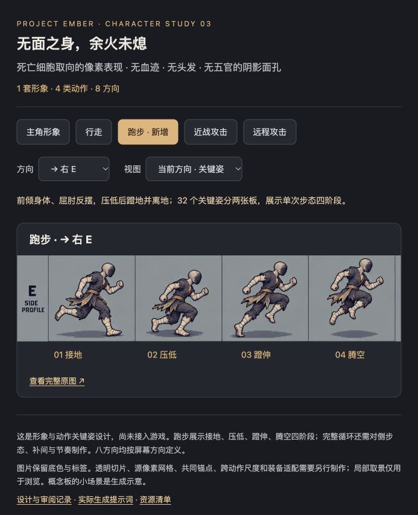

# 主角修订 03：无面复燃者

2026-10-20，基线 `8a54f4c`。用户选择死亡细胞取向的像素表现，并确认基础角色无血迹、无头发、无五官，面部以阴影隐藏。新增八方向跑步关键姿；同步更新行走、近战、远程设计中的人物身份。

**本批次是形象与关键姿设计，尚未接入 Cocos。** 方向与无血 / 无发 / 无五官要求来自用户；具体新图的衣物、体型和余火形状仍可调整，未记作用户逐项批准。旧版保留在 [双风格研究](../rekindled-style-studies-v2/README.md)。

## 查看

[打开本地设计页](index.html)，或使用本机正在运行的 [8083 预览](http://127.0.0.1:8083/)。可选择概念、行走、跑步、近战、远程，以及屏幕八方向 / 整板；页面仅展示图片，没有第二套游戏实现。

服务停止后可直接打开 HTML，或从仓库根运行：

```bash
python3 -m http.server 8083 --bind 127.0.0.1 --directory art-source/rekindled-hero-v3
```

| 选用设计板 | 实际尺寸 | 内容 |
| --- | --- | --- |
| [concept.png](concept.png) | 1536×1024 | 完整形象、背面、阴影面孔和干裂余火特写、生成的尺度示意 |
| [walk.png](walk.png) | 1024×1536 | N / NE / E / SE / S / SW / W / NW，每向3姿，共24格 |
| [melee.png](melee.png) | 1024×1536 | 同上8方向；张臂、交叉挥击、回收，共24格 |
| [ranged.png](ranged.png) | 1024×1536 | 同上8方向；蓄势、单掌释放、回收，共24格 |
| [run-north.png](run-north.png) | 1254×1254 | N / NE / E / SE，每向接地、压低、蹬伸、腾空，共16格 |
| [run-south.png](run-south.png) | 1254×1254 | S / SW / W / NW，同上4阶段，共16格 |

共6张选用板、104个动作格，其中跑步32格。行走和跑步分别制作，跑步强调前倾、屈肘反摆和可见离地。跑步四姿展示**单次步态的阶段**，不声称已经完成左右交替的整段循环；完整循环还需对侧腿步态、过渡和时序。标签里的方向按屏幕定义，N背面、S正面。



## 人物约束

- 基础身体无血，包括衣物、裹布和胸口；以干枯灰白皮肤、灰烬与焦化表现死去已久。此限制不取消世界、敌人和战斗整体的黑暗血腥基调。
- 光头保留人形头颈轮廓；脸部是一块深灰阴影，没有眼、鼻、口、眉或耳部细节，也没有发光眼。没有用头盔、面具或兜帽掩盖原有头部。
- 简朴灰蓝旧布、灰白裹布、赭灰腰带，胸口火星位于干燥焦裂中；不采用旧图的红色染血衣物。
- 不带职业武器和固定盔甲。装备负责构筑外观；普攻形式仍由余烬决定。
- 胸口余火是局部身份提案；刀光、弹体、命中特效以后独立制作。本轮不增加新的攻击机制或跑步按键。

## 实际生成与修订

工具：内置 `image_gen`，未调用 CLI / API 付费后备路线。使用了v2 A概念和三类动作板作为编辑参考；先检查原图，再完成新身份，以新概念作为全部动作的共同参考。原图完整复制到本目录，未用脚本重绘、裁切或去底。

- `concept-draft.png`：初稿仍有耳部细节；局部编辑去除后选用 `concept.png`。
- `run-draft.png`、`run-draft-02.png`：8×4密集板尝试，左右步态差异不足，若干“腾空”脚仍接地；不采用。
- 改为两张4×4板，展示单次步态四阶段。`run-south-draft.png` 后两列的SW/W/NW朝向错误；定点修正六格后选用 `run-south.png`。
- 原样保存全部10次实际提示词于 [prompts.json](prompts.json)，对应输入参考、输出名、尺寸和 SHA-256 见 [manifest.json](manifest.json)。4张过程稿保留供排错，不在预览页冒充成品。

## 验收与生产边界

[validation.json](validation.json) 记录本轮实际检查。已检查新身份在所有板上的一致性、八方向覆盖、近战背面遮挡、跑步压低 / 腾空差异及方向修正；已在浏览器检查设计页和局部取景。

仍未覆盖生产验收：

- 设计板保留背景、网格、文字和地面阴影，不能直接导入运行时。没有透明切片、源低分辨率网格或有限色板验收。
- 行走的部分左右步区分偏弱；跑步为单次步态四阶段，少数侧向姿的躯干扭转幅度偏大。正式循环需统一肢体前后关系、对侧支撑腿、重心和帧间时间，不能把这几张姿势直接快速翻页当完整动画。
- 远程的手侧和肩部扭转仍需按完整方向表精修；跨动作身体尺度、共同画布、脚底锚点、头 / 身 / 肢体拆分以及装备适配未完成。
- 跑步腾空需要共同地面 pivot 与固定画布，不能逐帧裁到最低像素贴地。当前 `HeroRig` 是六部件纸娃娃加左右镜像，未实现八方向跑步播放器。
- 没有改游戏源码、运行时素材、移速、伤害、碰撞或存档。没有进行 Cocos 构建 / 游戏动画验收，也没有提交或推送 Git。

当前规则维护在 [世界观](../../docs/WORLD_LORE.md)、[美术指南](../../docs/ART_DIRECTION.md) 与 [ember-art](../../.agents/skills/ember-art/SKILL.md)，后续制作以这些文件和用户最新指令为准。
