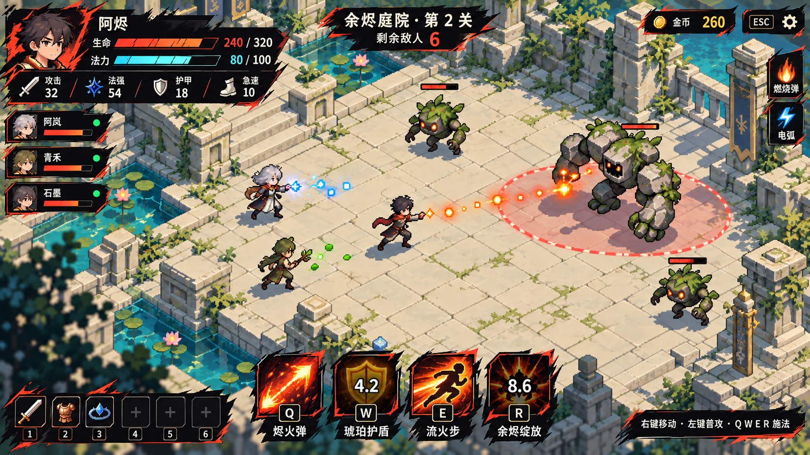

# UI 候选 B：Hades 图形气质 v2

2026-10-16，按用户反馈保留 v1 总体布局，重做战斗 HUD、增益和商店三张代表屏。借鉴《哈迪斯》的强明暗、锋利轮廓、版画感图标与强调色，改成炭黑 / 墨紫大面、骨白字、朱砂按钮及冰青 / 浅绿功能色。移除旧式双层细金框、花角与棕金浮雕按钮。项目原创像素遗迹、角色和名词保持，不使用《哈迪斯》角色、标志或专有素材。

这是供比较的静态候选，**尚未定稿或接入游戏**；v1 保留。主菜单和房间三屏本轮未重做。完整方案对照见 [UI_DESIGN](../../docs/UI_DESIGN.md)，实际 Prompt 见 [prompts.md](prompts.md)。

## 优先比较：战斗 HUD 精修

初试 01–03 的红黑抓痕较密，审阅认为气质偏漫画涂鸦，因此追加一次 HUD 定向精修，作为本轮优先展示的 HUD。移除大部分抓痕、碎纸边和头像火边，保留干净黑曜石 / 墨紫大面，使用克制的骨白奶金单层刀切轮廓及少量原创菱形节点；布局、像素世界与亮度不变。没有全面重做其他两屏，01–03 保留作方案过程对照。

## 三屏预览

### 战斗 HUD

保留左上自己的 HP / MP / 属性、左侧队友、右侧增益、下方 QWER CD 及六个通用装备栏。地图名改为“余烬庭院”。场景亮度和人物 / 敌人 / 预警构图基本保留，UI改为黑色斜切底牌和朱砂刀痕。

### 增益选择

保留三选一卡、收益 / 联动 / 当前技能与确认进度，图标改为火色、冰青、浅绿的版画式大形状；选中电弧用青色切角与勾选，确认按钮是平面朱砂色块。

### 商店

保留三栏货架 / 详情与预览 / 人物六装备栏、金币与整备入口；高对比标题、切角选中及平面购买按钮。商品与价格、法强 24 → 54、急速 0 → 10 为排版示例。

## 真实来源

内置 `image_gen`，3 次独立编辑调用 + 1 次 HUD 定向精修；没有 CLI / API 或程序绘图。工具返回本机目录：`C:\Users\Administrator\.codex\generated_images\01a144af-9769-7933-b64a-6dcdf3c23a7d\`。本机源路径只作审计，不是运行时依赖；最终图均已复制到本目录。

| 本地最终文件 | 工具返回源文件 | 实测尺寸 |
| --- | --- | --- |
| 01-combat-hud.png | `exec-ed2da1fb-0bf0-4c60-8d4f-721ea4ef7f4b.png` | 1672×941 |
| 02-augment-choice.png | `exec-cb3ea6b4-d533-4f7d-af4a-a037fe5d0b72.png` | 1672×941 |
| 03-shop.png | `exec-fbf20c70-d1f1-4805-a52b-e3b166d4ee03.png` | 1672×941 |
| 04-combat-hud-refined.png | `exec-e32e5ef7-bb9a-48ad-8b99-934c2dad70af.png` | 1672×941 |

1280×720 为目标设计视口，实际约 16:9，未重采样或保证精确生产稿坐标。字体、交互状态和分层资产后续应使用真实UI组件重排。

## 自检与待处理

- 四图逐屏目视检查，核心布局、信息、四技能 / 六装备栏 / 三卡均保持；商店六真实商品和购买比较没有因风格变化丢失。像素背景没有被整体压暗来代替UI重设，增益屏沿用原图本来就有的遮罩。
- 少量“烬 / 绽 / 垒”等中文仍有生成字形变体；正确技能名为 **烬火弹、琥珀护盾、流火步、余烬绽放**，商品包含 **壁垒重盾**。实施时从配置读取，不能把位图文字直接当最终文案。
- 初试 01–03 刀痕 / 笔刷纹理偏强，04 已显著减轻；部分图标保留像素或发光观感。它们是待用户比较的视觉表达，不宣称已完全复刻某游戏或达到生产标准。背景局部景深与像素密度问题沿自 v1，不作为新规范。
- MP 为玩家 UI 提案：引擎已有 mana 基础能力，当前玩家未启用法力资源、现有技能没有配置耗蓝。增益图三个被动卡仅为版式示例，保留实际奖励尽量两个被动 + 一个未装备技能的规则，后续仍需技能替换状态。价格和属性只是示例，不改变玩法。
- 已检查 PNG 头 / 尺寸、本目录相对链接；没有改源码 / Cocos 运行时资源，没有构建或玩法测试，也没有提交推送。

