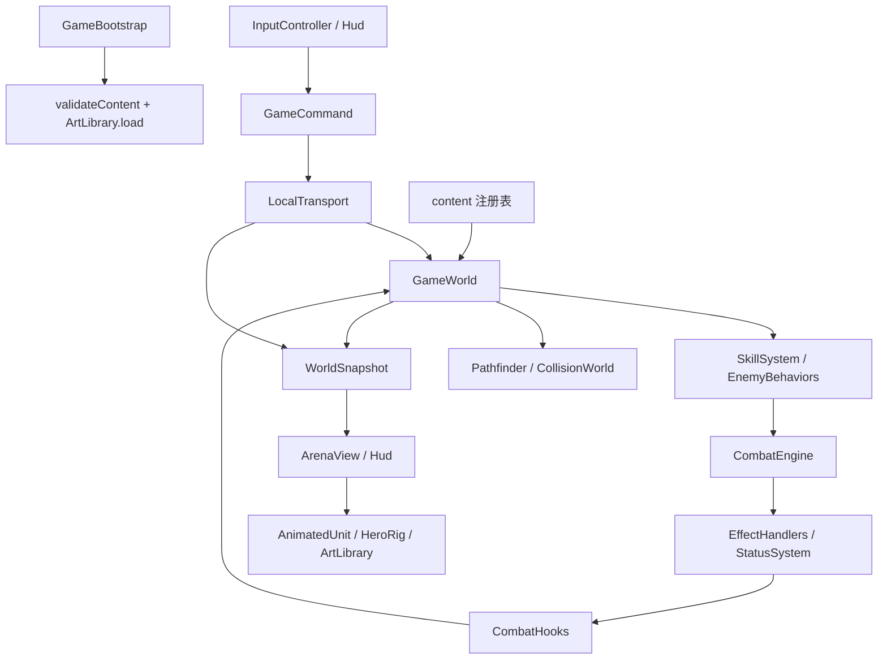
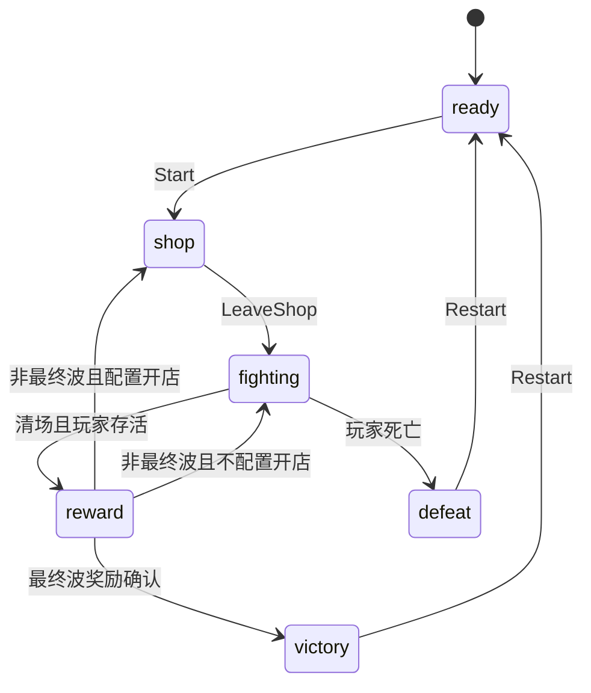

# 整体架构

本文描述当前实现，而不是未来规划。代码核对基线：v0.6，包含人物挂点修复（`93126d9`）。具体数值以源码为准；增加内容按 [内容扩展指南](CONTENT_ARCHITECTURE.md)，实施与验证按 [开发架构指南](DEVELOPMENT_GUIDE.md)。

## 工程边界

这是一个单机权威模拟、Cocos 2D 表现的等距视角游戏。一个仓库、一个 Creator 工程、同一份 TypeScript 源码同时用于游戏和无引擎测试。没有 ECS 框架、服务端、远程内容下发或运行时插件加载器。

```text
仓库根目录
├── AGENTS.md                    AI 协作者入口
├── package.json / pnpm-lock.yaml 依赖与验证命令
├── EmberDemo/                   Creator 3.8.8 工程
│   ├── assets/Main.scene        编辑器生成的 Canvas / Camera / GameBootstrap
│   ├── assets/scripts/ember/    唯一游戏源码
│   ├── assets/resources/art/    本地 PNG 与 .meta
│   ├── settings/ .creator/     共享工程设置
│   └── build-templates/         Web Desktop 页面模板
├── tests/                       Vitest 纯逻辑测试
├── scripts/                     服务、浏览器回归、基准、图集检查
├── art-source/                  参考与资源制作记录
├── docs/                        当前指南与历史记录
└── reports/                     验证结果；图片 / 日志按 .gitignore 留本机
```

`EmberDemo/build / library / temp` 和根目录 `dist-core` 是产物，不是编辑源。`UnitVisuals.ts` 是旧几何角色参考，当前人物入口为 `HeroRig`，怪物入口为 `AnimatedUnit`。

## 模块职责与依赖

以下源码路径相对于 `EmberDemo/assets/scripts/ember/`。

| 模块 | 拥有的职责 | 主要连接 |
| --- | --- | --- |
| `bootstrap/GameBootstrap.ts` | 初始化校验、资源加载、创建系统、每帧调度、销毁 | 组装 LocalTransport / InputController / ArenaView / Hud |
| `input/InputController.ts` | 键鼠状态、CSS 像素归一化、坐标逆投影、输入释放 | 只通过 CommandPort.send 提交玩法命令 |
| `platform/protocol.ts` | GameCommand 数据联合、CommandPort 接口 | 输入与逻辑边界 |
| `platform/LocalTransport.ts` | 当前世界、重开 / 换图、开发者草稿与应用、冻结调度 | send / advance / snapshot；实际使用的本机适配器 |
| `simulation/GameWorld.ts` | 实体、弹体、挥击、时间、阶段、技能冷却、各系统协调 | 技能、AI、战斗、装备、奖励、导航 |
| `simulation/SkillSystem.ts` | 按 behavior.kind 分派技能，声明所需能力 | 通过上下文请求发射、冲刺和反馈 |
| `simulation/EquipmentSystem.ts` | 金币、库存、装备事务 | 依赖装备定义；阶段权限由 GameWorld 控制 |
| `simulation/RewardSystem.ts` | 根据已拥有增益 / 当前技能生成候选 | 使用传入的有种子 Random |
| `combat-core/CombatEngine.ts` | 伤害、治疗、事件队列、规则条件、限频、连锁保护 | 通过 CombatHooks 请求弹体 / 冷却操作 |
| `combat-core/EffectHandlers.ts` / `StatusSystem.ts` | 效果原语、状态施加与计时 | 不导入 GameWorld 或 Cocos |
| `combat-core/CollisionWorld.ts` | 形状相交、遮挡、连续弹体命中 | 只使用世界坐标 / 角色体积 / 地形 |
| `ai/EnemyBehaviors.ts` / `Pathfinder.ts` | 敌人决策、半格网格寻路、移动扫掠 | 行为上下文由 GameWorld 注入 |
| `content/` | 稳定 ID、配置、类型、外观和引用校验 | 被逻辑与表现读取 |
| `render/` | 地图、角色、装备、HUD、图集、可视反馈 | 读取快照；UI 按钮回送命令 |
| `utils/` | 向量数学与确定性 Random | 无引擎依赖 |

规则层和模拟层不依赖 `cc`；`render/IsoProjection.ts` 虽放在 render 目录，也是纯函数。`content` 不是外部 JSON 数据库：它是编译期 TypeScript 注册表，部分函数负责统计 / 校验。`CombatEngine` 会读取技能和增益配置，配置与核心之间也存在类型引用；本项目保证的是不依赖渲染引擎，尚未拆成可单独发布的包。

## 从输入到画面



1. `GameBootstrap.start` 校验内容并加载图集，然后创建当前世界、输入与视图。
2. 原生事件转为 `MoveTo / Attack / CastSlot` 等命令；按住移动 / 攻击还会在输入更新时提交持续状态。当前命令同步处理，没有带 tick 的网络输入缓冲。
3. `GameBootstrap.update(dt)` 调用 `LocalTransport.advance(dt)`。开发者面板打开时在此冻结推进，否则交给 `GameWorld.advance`。
4. GameWorld 采用 1/30 秒固定步进，最多接收本次真实帧的 0.25 秒；开发者倍率缩放推进量。返回剩余累计时间比例供画面插值。
5. 取得快照后更新输入状态，再更新 ArenaView 与 Hud。单位和弹体位置从 previous / 当前坐标插值；伤害不由插值或动画决定。

注意：`Attack / CastSkill` 等命令会同步创建挥击、弹体，某些范围技能会同步结算命中；不是所有操作都等下一次 `step` 才生效。所谓确定性要求相同版本、内容、种子以及相同模拟时刻的命令顺序，不能把相近的鼠标点击时间当成完全相同输入。

### 单次逻辑步的顺序

`GameWorld.step` 依次：记录实体上一位置 / 扣减攻击计时 → 扣减技能冷却 → 战斗状态与延迟效果 tick → 玩家移动与持续普攻 → 敌人 AI → 近战挥击 → 弹体碰撞 → 提示计时 → 死亡与清场检查。

该顺序决定同帧边界行为。修改它需要验证同时死亡、最后一个敌人死亡、持续伤害、冲刺与弹体相交；不能只观察一场胜利。玩家死亡先于波次奖励结算。

## 状态归属与接口

| 数据 | 权威位置 | 表现侧如何获得 |
| --- | --- | --- |
| HP、护盾、状态、位置、朝向 | GameWorld.actors / hero，由战斗和模拟系统修改 | 快照 hero / units |
| 装备、金币、库存 | EquipmentSystem | equipment / gold / inventory / stats |
| 四槽技能、冷却、奖励预选 | GameWorld.loadout / cooldowns / pendingSkill | 槽位化冷却与 RewardChoice |
| 已获得增益、规则冷却、计数 | CombatEngine | perks / primed / metrics；内部计数不暴露为可变引用 |
| 投射物、近战窗口、延迟区域 | GameWorld / CombatEngine.zones | projectiles / swings / zones |
| 开发者草稿、已应用配置 | LocalTransport | developer 快照 |
| 鼠标、按键、操作方式 | InputController | 输入命令；操作方式保存在浏览器本地 |
| Node、SpriteFrame、显示缓存 | render 与 ArtLibrary | 不进入世界状态 |

`WorldSnapshot` 是用于显示和检查的脱离实例的副本，不是完整存档；新加嵌套字段必须复制，不能返回 live Map/Set/Actor。`CommandPort` 当前只声明 `send`，`advance / snapshot` 是 LocalTransport 的具体能力。当前协议不包含网络鉴权、序号、版本协商、回滚或反序列化完整世界；未来联网需要另外实现这些能力。

## 阶段与重置



技能奖励先设置 pendingSkill，玩家确认替换槽位才推进；取消不会重新抽取。暂停是 fighting 上的布尔状态，不是独立 Phase。普通模式只允许 shop 阶段购买 / 换装，换图只在 ready 接受；LocalTransport 处理 Restart，创建新世界。开发者模式显式绕过正常整备流程，清场后留在战斗现场，不自动领奖。

波次切换清除敌人、弹体、挥击、提示、英雄负面状态 / 护盾、技能冷却、输入、冲刺和本场增益计时 / 计数，保留构筑、金币与累计击杀；第一波补满生命，后续波次补 30。重开创建新世界，回到所选地图的初始配置。开发者应用 / 重测也创建新世界，以其已验证配置重建，不恢复战斗中间状态。

## 四条关键内容链路

### 技能与普攻

技能链路为 `CastSlot → loadout[slot] → cast → executeSkill → behavior handler`。技能 ID 与槽位、按键、外观 ID 分开；玩家技能由 `hero` 标签进入奖励池。当前行为有 projectile / shield / dash / area / cone。

普攻由装备的 `attack` 引用 `BASIC_ATTACKS`，伤害 / 间隔 / 射程来自属性计算。近战产生带前摇、生效窗口和去重集合的扇形；远程产生真正飞行的弹体。输入不提交锁定目标 ID。普攻弹体 `cause: basic`、没有 skillId；不要为了复用逻辑把它标成技能。

### 伤害、事件与效果

实际命中调用 `CombatEngine.damage`：检查目标 → 判断确定性暴击 → 应用伤害策略与真实附伤 → 预留事件预算 → 扣护盾 / 生命 → 排入命中、攻击特效、受伤、击杀事件 → 执行规则。效果处理器通过上下文调用 damage / heal / hooks，不能反向导入 GameWorld。

`OnAttack` 是出手，`OnAttackHit` 是攻击特效，`OnHit` 是伤害命中，`OnDamaged` 是玩家实际掉血，`OnHeal` 是有效治疗；各自用途不同。派生效果携带 `proc`，`appliesOnHit` 必须有意开启，`unscaled` 防止比例附伤再次乘技能威力。链深度上限 6、根事件预算 128、按根 / 规则 / 目标去重；规则执行使用内容定义顺序，不使用增益获取顺序。

详细数值和触发边界见 [海克斯说明](HEX_AUGMENTS.md)。新增事件或原语同时检查类型、处理器、内容校验、来源传递和重置逻辑。

### 装备与属性

`EQUIPMENT → EquipmentSystem → deriveStats → GameWorld 实际消费`。平坦属性相加，百分比先汇总；攻速 / 急速换算为间隔 / 冷却倍率。GameWorld 再应用增益的最大生命倍率。新属性仅写入装备对象没有效果，必须接通类型、推导、实际消费和可见说明。

装备定义的 appearance 接入 `EQUIPMENT_APPEARANCES / EQUIPMENT_SPRITES → HeroRig`。战斗行为与外观独立；掌心 / 肩部挂点及镜像规则见 [美术管线](ART_PIPELINE.md)。基础人物不因技能选择变成某个职业。

### 敌人与地图

`MAPS.waves.spawns → ENEMIES → behavior / skillId / appearance`。普通刷怪由 GameWorld 选择安全位置；EnemyBehaviors 接收移动、伤害与施法能力。远程实际弹体伤害来自其技能 behavior，出手间隔来自敌人 interval，不能只改 EnemyDefinition.damage 或技能 cooldown 就认为远程攻击已改。

地图同一份尺寸 / 障碍供导航、碰撞、投影、刷怪和环境使用；装饰图片不自动成为障碍。新 Boss 的大贴图不意味着已有多阶段 AI，需要明确实现行为和状态。

## 坐标、碰撞与时间

- 逻辑坐标单位是地图格，时间是秒，角度 / 扇形宽度是弧度；渲染节点 angle 使用 Cocos 的角度单位。不要混用。
- 角色位置是地面脚底中心，radius 是世界空间受击圆；图集像素和衣服大小不参与判定。
- `IsoProjection` 提供成对投影，UI 逻辑坐标原点在中央、Y 向上；浏览器像素 Y 向下。输入还处理 CSS 缩放、设备像素比与视口，不能用固定屏幕偏移替代逆投影。
- `CollisionWorld.targets` 统一做圆 / 扇形 / 胶囊相交、敌我 / 存活过滤、遮挡和稳定排序；`firstImpact` 做弹体连续扫掠，考虑角色相对移动，墙同时接触时优先。
- 移动与冲刺通过 `Pathfinder.sweep`，当前是细分采样的移动扫掠；它不是弹体使用的解析连续相交算法。
- 刷怪 / 奖励共用世界 Random，暴击另用从世界 seed 派生的随机流。新增一次随机调用或改变目录枚举顺序可能改变同种子的后续结果。

## 表现与资源生命周期

ArtLibrary 统一加载本地图集，创建共享 Texture2D / SpriteFrame；AnimatedUnit 播放怪物序列帧，HeroRig 组合人物和装备。ArenaView 复用单位节点、按脚底屏幕 Y 排序，消费 cue 绘制浮字与特效；Hud 按状态重建面板。

模拟提供 facing / action / hurtAt / diedAt，`motionPose` 选择状态。死亡优先于受击，受击优先于攻击 / 施法；表现计时不反向触发伤害。死亡后最多保留短暂淡出，暂停冻结动作；非战斗阶段可延续死亡显示。新增资源要走同一加载 / 清理周期，不在逐帧更新中反复加载纹理。

## 已有边界与扩展时需特别检查的地方

| 当前边界 | 扩展时的处理 |
| --- | --- |
| 无账号、多人、存档 / 输入录像、触控和发行 SDK | 作为独立需求设计，不能把现有命令边界描述成已经联网 |
| 英雄 dash 状态在 GameWorld 单独保存 | 不能直接把英雄 dash 配给敌人；先扩展到实体或实现敌人专用行为 |
| area 以施法者为中心，弹体首次碰撞即消失 | 指定落点 AOE、穿透、追踪、持续施法需新机制及判定 |
| 静态矩形地图、圆障碍、无角色刚体推挤 | 动态地形、房间串联、多边形、群体避让不是已有配置开关 |
| 导航网格默认按半径 0.36 预计算，移动用角色实际半径 | 大型敌人可能找到自身无法通过的窄路；增加大体型要验证路线，必要时按半径建立导航 |
| 普通波次刷怪间距目前固定比较 0.9；开发者刷怪按半径和判断 | 放大敌人体积时检查出生重叠，不要假设已有通用大体型支持 |
| 玩家渲染硬编码三个装备层；装备图集固定为 equipment | 新槽或单独装备图集需要改渲染与 UI，不是只增加一个 ID |
| HeroRig 为左右镜像纸娃娃，怪物为双向序列帧 | 八方向、独立上 / 下半身、Spine 需要新的资源和表现接入 |
| content/validate.ts 覆盖主要引用与数值，不覆盖所有语义 | 标签拼错、握点错位、路径可达、触发递归等仍需专项验证 |

后续可以逐步提取模拟内部职责，但新增一个同类技能或装备，不应顺带引入 ECS、联网层或重写整个 GameWorld。优先保持当前边界与现有玩法可验证。
