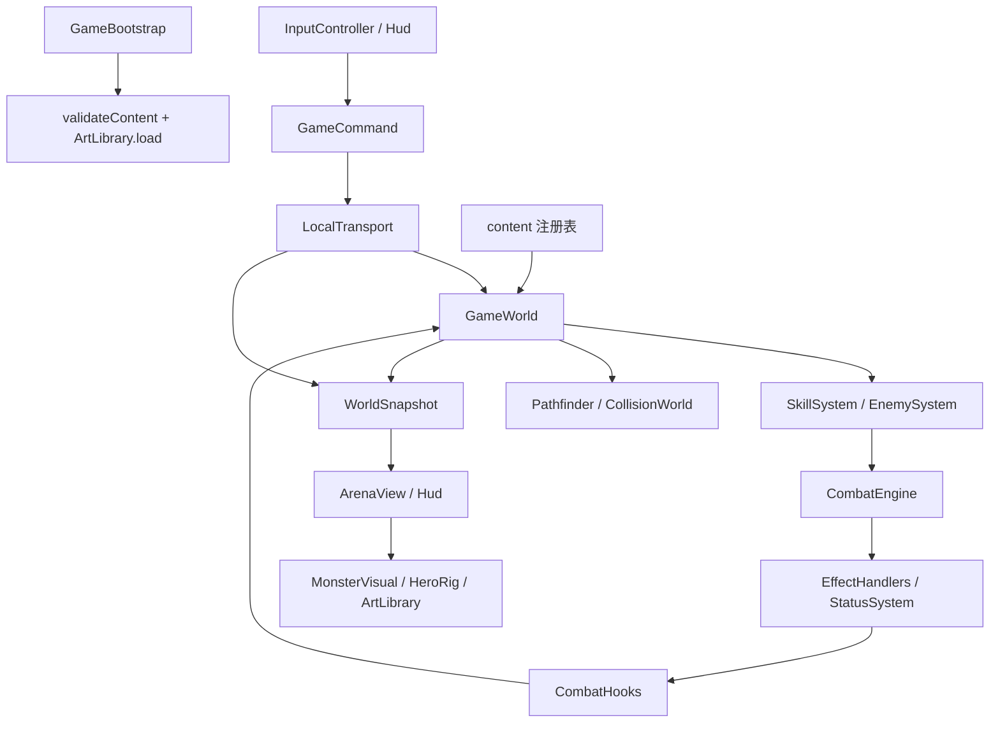
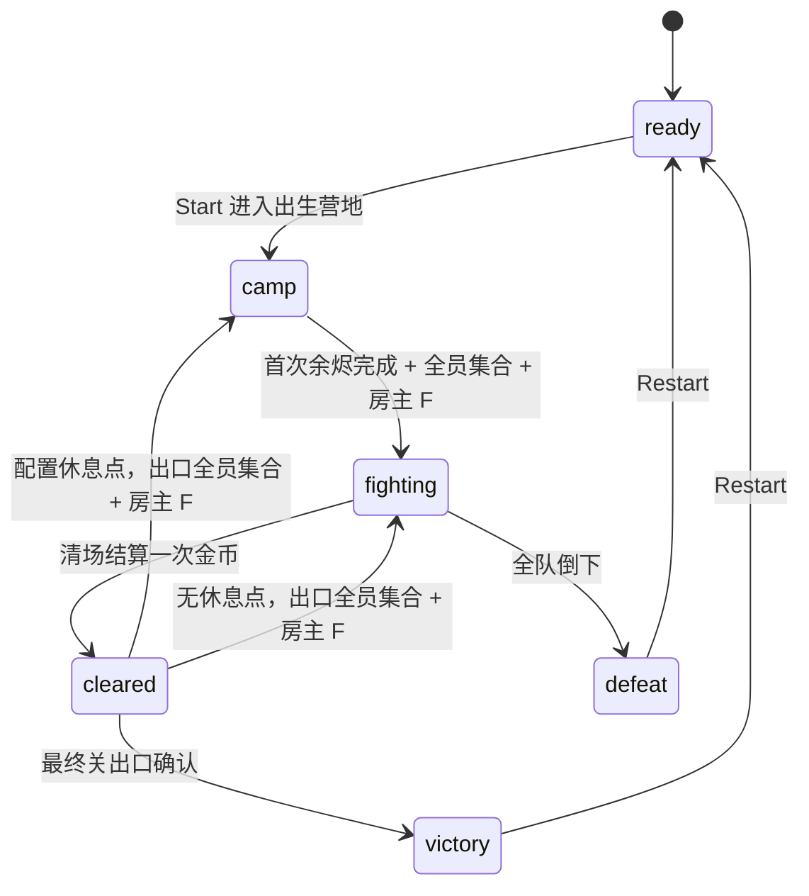

# 整体架构

本文描述当前实现，而不是未来规划。代码核对基线：v0.8 营地 / 休息点交互 + 统一属性 v1，房间协议 ember-coop-7、恢复点 v4。具体数值以源码为准；增加内容按 [内容扩展指南](CONTENT_ARCHITECTURE.md)，实施与验证按 [开发架构指南](DEVELOPMENT_GUIDE.md)。

统一属性规则见 [属性系统](ATTRIBUTE_SYSTEM.md)：所有单位共用，技能只读总 AD、仅全能吸血。每个 Actor 由 ActorFactory 创建并持有独立 AttributeSet；HeroStats 是面板兼容视图，不另算英雄专用公式。当前接入17种敌人、六个通用装备栏和两图各五关；18件装备均已注册，含独立装备被动模块与商店详情。

## 工程边界

这是一个单人 / 房主权威模拟、Cocos 2D 表现的等距视角游戏。一个仓库、一个 Creator 工程、同一份 TypeScript 源码同时用于游戏和无引擎测试。没有 ECS 框架、远程内容下发或运行时插件加载器。联机服务只管理房间、转发和持久保存，不运行战斗；详见 [联机与恢复](MULTIPLAYER.md)。

```text
仓库根目录
├── AGENTS.md                    AI 协作者入口
├── package.json / pnpm-lock.yaml 依赖与验证命令
├── EmberDemo/                   Creator 3.8.8 工程
│   ├── assets/Main.scene        编辑器生成的 Canvas / Camera / GameBootstrap
│   ├── assets/scripts/ember/    唯一游戏源码
│   ├── assets/resources/art/    本地 PNG 与 .meta
│   ├── settings/ .creator/     共享工程设置
│   └── build-templates/         Web Desktop 页面模板
├── tests/                       Vitest 纯逻辑测试
├── scripts/                     服务、浏览器回归、基准、图集检查
├── art-source/                  参考与资源制作记录
├── docs/                        当前指南与历史记录
└── reports/                     验证结果；图片 / 日志按 .gitignore 留本机
```

`EmberDemo/build / library / temp` 和根目录 `dist-core` 是产物，不是编辑源。`UnitVisuals.ts` 是旧几何角色参考，当前人物入口为 `HeroRig`，怪物入口为 `MonsterVisual` 的 PNG 帧组，程序轮廓和旧怪物 PNG 播放器保留兼容。

## 模块职责与依赖

以下源码路径相对于 `EmberDemo/assets/scripts/ember/`。

| 模块 | 拥有的职责 | 主要连接 |
| --- | --- | --- |
| `bootstrap/GameBootstrap.ts` | 初始化校验、资源加载、创建系统、每帧调度、销毁 | 组装 RoomTransport（单人内含 LocalTransport）/ InputController / ArenaView / Hud |
| `input/InputController.ts` | 键鼠状态、CSS 像素归一化、坐标逆投影、输入释放 | 只通过 CommandPort.send 提交玩法命令 |
| `platform/protocol.ts` | GameCommand 数据联合、CommandPort 接口 | 输入与逻辑边界 |
| `platform/RoomTransport.ts` / `RoomPanel.ts` | 单人 / 房间适配、房主模拟调度、断线重连、保存确认、浏览器房间入口 | LocalTransport 或 GameWorld；轻量中转 |
| `platform/LocalTransport.ts` | 当前世界、重开 / 换图、开发者草稿与应用、冻结调度 | send / advance / snapshot；实际使用的本机适配器 |
| `simulation/GameWorld.ts` | 实体、弹体、挥击、时间、阶段、技能冷却、各系统协调 | 技能、AI、战斗、装备、奖励、导航 |
| `simulation/SkillSystem.ts` | 按 behavior.kind 分派技能，声明所需能力 | 通过上下文请求发射、冲刺和反馈 |
| `simulation/EquipmentSystem.ts` | 金币、库存、装备事务 | 依赖装备定义；阶段权限由 GameWorld 控制 |
| `combat-core/ActorFactory.ts` / `attributes/AttributeSet.ts` | 创建全单位属性实例，解析模板及来源、缓存与明细 | 装备 / 余烬 / 状态提供来源；技能、AI、战斗读取结果 |
| `simulation/RewardSystem.ts` | 根据已拥有余烬 / 当前技能生成候选 | 使用传入的有种子 Random |
| `combat-core/CombatEngine.ts` | 伤害、治疗、事件队列、规则条件、限频、连锁保护 | 通过 CombatHooks 请求弹体 / 冷却操作 |
| `combat-core/EffectHandlers.ts` / `StatusSystem.ts` | 效果原语、状态施加与计时 | 不导入 GameWorld 或 Cocos |
| `combat-core/CollisionWorld.ts` | 形状相交、遮挡、连续弹体命中 | 只使用世界坐标 / 角色体积 / 地形 |
| `simulation/EnemySystem.ts` / `content/enemy-actions.ts` | 敌人守区、锁向、分段动作、Boss循环/阶段、敌弹/预警 | GameWorld一次固定步进；共用CombatEngine/CollisionWorld |
| `simulation/LevelSystem.ts` | 每关起点、路线、固定敌群、清场后出口条件 | maps.waves[].level；GameWorld阶段推进 |
| `ai/Pathfinder.ts` | 半格网格、移动扫掠、PathfinderPool体型分组 | 敌人使用不小于自身半径的缓存导航；旧EnemyBehaviors不调度新敌人 |
| `content/` | 稳定 ID、配置、类型、外观和引用校验 | 被逻辑与表现读取 |
| `render/` | 地图、角色、装备、HUD、图集、可视反馈 | 读取快照；UI 按钮回送命令 |
| `utils/` | 向量数学与确定性 Random | 无引擎依赖 |

规则层和模拟层不依赖 `cc`；`render/IsoProjection.ts` 虽放在 render 目录，也是纯函数。`content` 不是外部 JSON 数据库：它是编译期 TypeScript 注册表，部分函数负责统计 / 校验。`CombatEngine` 会读取技能和余烬配置，配置与核心之间也存在类型引用；本项目保证的是不依赖渲染引擎，尚未拆成可单独发布的包。

## 从输入到画面



1. `GameBootstrap.start` 校验内容并加载图集，然后创建 RoomTransport、输入与视图。未加入房间时 RoomTransport 委托 LocalTransport。
2. 原生事件转为 `MoveTo / Attack / CastSlot` 等命令；按住移动 / 攻击还会在输入更新时提交持续状态。单人命令同步处理。联机命令经白名单和序号检查进入房主队列，按玩家 ID 在模拟推进前处理。
3. 单人模式下 `GameBootstrap.update(dt)` 经 RoomTransport 调用 `LocalTransport.advance(dt)`；联机时只有房主的 RoomTransport 计时调度推进 GameWorld，渲染帧只读快照。开发者面板打开时在此冻结推进，否则交给 `GameWorld.advance`。
4. GameWorld 采用 1/30 秒固定步进，最多接收本次真实帧的 0.25 秒；开发者倍率缩放推进量。返回剩余累计时间比例供画面插值。
5. 取得快照后更新输入状态，再更新 ArenaView 与 Hud。单位和弹体位置从 previous / 当前坐标插值；伤害不由插值或动画决定。最后更新 SceneTransition：地点变化以 0.22 秒本地黑幕淡出遮住换景，再浮现快照中的地点名称 / 可选副标题。地图、关卡、营地和休息点共用 `LocationDefinition`，名称经 `sceneLocation` 进入每玩家快照。UI 时钟独立于暂停中的模拟；不延迟命令与房主推进，也不为个人面板或清场重播过渡 / 标题。配置示例见 [地点名称](SCENES.md#地点名称与入场标题)。

注意：`Attack / CastSkill` 等命令会同步创建挥击、弹体，某些范围技能会同步结算命中；不是所有操作都等下一次 `step` 才生效。所谓确定性要求相同版本、内容、种子以及相同模拟时刻的命令顺序，不能把相近的鼠标点击时间当成完全相同输入。

### 单次逻辑步的顺序

普通步行在模拟层通过GroundMovement补偿54×28等距投影的纵向压缩，WASD、玩家路径移动与敌人走路共用；基准移速仍由AttributeSet解析，右键加速 / 刹停使用投影距离。世界碰撞与技能距离保持世界坐标语义，渲染不二次修改移动速度；细节见[手感参数](GAME_FEEL.md)。

`GameWorld.step` 依次：记录实体上一位置 / 扣减攻击计时 → 扣减技能冷却 → 战斗状态与延迟效果 tick → 玩家移动与持续普攻 → EnemySystem（敌人AI/分段预警/敌弹）→ 玩家近战挥击 → 玩家/余烬弹体碰撞 → 提示计时 → 死亡与关卡出口检查。

该顺序决定同帧边界行为。修改它需要验证同时死亡、最后一个敌人死亡、持续伤害、冲刺与弹体相交；不能只观察一场胜利。参与战斗的玩家全部死亡先于波次奖励结算；个别玩家死亡后，其他人可继续。安全场景中商店与余烬为个人面板，出发时按全队位置检查。

## 状态归属与接口

| 数据 | 权威位置 | 表现侧如何获得 |
| --- | --- | --- |
| HP、法力、独立护盾、状态、位置、朝向 | GameWorld.actors，由战斗和模拟系统修改 | 快照 hero / units |
| 属性模板、来源与最终结果 | 每个 Actor.attributes；共享模板只读，来源独立 | attributeValues / attributeExplanation / movementPoints / worldMoveSpeed |
| 装备、金币、库存 | EquipmentSystem | equipment / gold / inventory / stats |
| 四槽技能、冷却、奖励预选 | GameWorld.loadout / cooldowns / pendingSkill | 槽位化冷却与 RewardChoice |
| 已获得余烬、规则冷却、计数 | CombatEngine | perks / primed / metrics；内部计数不暴露为可变引用 |
| 投射物、近战窗口、延迟区域 | GameWorld / CombatEngine.zones | projectiles / swings / zones |
| 开发者草稿、已应用配置 | LocalTransport | developer 快照 |
| 单人本地恢复点 / 文件元数据 | LocalTransport + 浏览器存储 | localSave 快照，仅用于按钮与保存反馈 |
| 鼠标、按键、操作方式 | InputController | 输入命令；操作方式保存在浏览器本地 |
| Node、SpriteFrame、显示缓存 | render 与 ArtLibrary | 不进入世界状态 |

`WorldSnapshot` 是用于显示和检查的脱离实例的副本，不是完整存档；新加嵌套字段必须复制，不能返回 live Map/Set/Actor。`CommandPort` 当前只声明 `send`，`advance / snapshot` 是 LocalTransport 的具体能力。房间协议另外实现成员身份、输入序号、版本检查和波次恢复；没有任意帧完整反序列化、回滚或无缝主机迁移。`RunCheckpoint` 只用于稳定阶段及波次起点。

单人由 LocalTransport 按世界身份 / checkpointRevision 自动写入浏览器；SaveRun 在安全阶段捕获位置，战斗仍使用本关起点。LoadRun 先验证文件 / 本地恢复点并重建 GameWorld，再替换世界，加载战斗时暂停。首页与暂停菜单提供入口，RunSaveFiles 只处理文件选择与下载；F2 测试局不写普通存档，联机白名单拒绝单人存取命令。格式及兼容范围见 [单人存档](SAVES.md)。

## 阶段与重置



shop/reward 是每玩家独立面板，不再是全局 Phase。WorldSnapshot.phase 为本地面板投影，stagePhase 为全局阶段；SceneSystem 计算交互距离、余烬领取与集合条件。首个余烬必选，后续配置余烬可跳过。关闭后重开保留候选；奖励选择不推进关卡，离开商店只关闭面板。具体配置与状态契约见 [场景指南](SCENES.md)。camp/cleared 推进移动与表现时钟，不调度战斗伤害、敌人 AI；暂停与打开本人面板清除旧输入。F2 默认进入战斗，可显式选择营地/休息点。

关卡切换按下一关start重新定位玩家，清除敌人、EnemySystem动作/预警/敌弹、玩家弹体、挥击、提示、英雄负面状态 / 护盾、技能冷却、输入、冲刺和本场余烬计时 / 计数，保留构筑、金币与累计击杀；第一波补满生命，后续波次补 30。重开创建新世界，回到所选地图的初始配置。开发者应用 / 重测也创建新世界，以其已验证配置重建，不恢复战斗中间状态。

## 四条关键内容链路

### 技能与普攻

普通开局的四个槽位均为显式 `null`，空槽冷却为 0、按键无操作；技能链路为 `CastSlot → loadout[slot] → cast → executeSkill → behavior handler`。技能 ID 与槽位、按键、外观 ID 分开；玩家技能由 `hero` 标签进入奖励池。当前行为有 projectile / shield / dash / area / cone。

玩家普攻默认 `BASIC_ATTACKS.slash`；`PerkDefinition.basicAttack` 引用形式配置，CombatEngine.basicAttackFor(playerId) 按该玩家余烬获得顺序解析，最后一个改变形式的余烬生效。形态射程由单一 `perk:attack-form` 属性来源替换，普通余烬不会重置形式；伤害 / 间隔 / 最终射程来自统一属性。装备不参与形式选择。近战产生带前摇、生效窗口和去重集合的扇形；远程产生真正飞行的弹体。输入不提交锁定目标 ID。普攻弹体 `cause: basic`、没有 skillId；不要为了复用逻辑把它标成技能。

### 伤害、事件与效果

实际命中调用 `CombatEngine.damage`：检查资格 → 读取采样伤害及命中属性 → 暴击 / 分类型附伤 → 抗性削减与穿透 → 计算各类型护盾吸收及生命损失 → 预留预算并提交 → 伤害、吸血治疗与事件链。混合真实附伤按组件结算，不能让真实部分再次过护甲；效果处理器通过上下文请求伤害 / 治疗 / hooks，不反向导入 GameWorld。

`OnAttack` 是出手，`OnAttackHit` 是攻击特效，`OnHit` 是伤害命中，`OnDamaged` 是单位实际掉血，`OnHeal` 是有效治疗。派生效果携带 `proc`，`appliesOnHit` 必须有意开启；显式表达式只计算一次，不再使用旧 skillPower / unscaled 放大策略。链深度上限 6、根事件预算 128、按根 / 规则 / 目标去重；规则执行使用内容定义顺序。所有阵营按 sourceId / targetId 读取对应属性与余烬；治疗派生伤害关闭吸血资格，避免反馈收益。

详细数值和触发边界见 [海克斯说明](HEX_AUGMENTS.md)。新增事件或原语同时检查类型、处理器、内容校验、来源传递和重置逻辑。

### 装备与属性

`单位模板 + 装备 / 余烬 / 临时来源 → AttributeSet → 技能 / AI / CombatEngine`。属性按来源替换或删除，再按各属性规则解析；攻速、急速、穿透、韧性、移速有各自规则。最大生命与当前生命分开，换装不回血；HeroStats / statsView 仅把统一结果转成面板字段。技能 AD/AP 表达式与伤害类型独立。新属性必须接通定义、解析、消费、可见说明和测试。

六个通用槽为slot1..slot6，每个ID仅拥有/装备一次，不限制category，可同时装备多个weapon/body/head。所有已装备条目都贡献属性；`purchaseOrder`决定每个category最后购买且仍穿戴者的显示，不影响普攻形式或射程。`EquipmentSystem.buy(id,replaceSlot?) / equip(id,slot?) / unequip(slot)`处理事务，满栏须显式选替换槽，库存保留；appearanceLoadout把六槽转换为三个显示层。

装备定义的 appearance 接入 `EQUIPMENT_APPEARANCES + EQUIPMENT_SPRITES或PROCEDURAL_EQUIPMENT → HeroRig`。战斗行为与外观独立；掌心 / 肩部挂点及镜像规则见 [美术管线](ART_PIPELINE.md)。基础人物不因技能选择变成某个职业。

### 敌人与地图

`MAPS.waves[].level.groups → enemyPlacements → ENEMIES.template → ActorFactory → EnemySystem`。每个地图是静态大图：ember 56×44、frost 60×44，各五关；关卡配置start/exit/route/groups，同地图不同关有独立起终点与固定敌群，不能用旧全图随机刷怪替代。清场进入 cleared 并结算一次金币，配置的清场余烬在出口附近出现；活跃玩家在出口radius集合后由房主按 F 推进，最终关同样确认出口后胜利。

17种单位分10小怪、5精英、2Boss，分别以actionSet引用`ENEMY_ACTION_SETS`和`ENEMY_ACTIONS`。动作含前摇/恢复、定向扇形/矩形、延迟圆/环、多段采样、非追踪弹、冲锋、独立类型/表达式；普攻cause=basic、技能cause=enemy。`content/enemy-behaviors.ts` 的profile（默认actionSet同名，可用ai覆盖）配置目标、优先级规则和有限序列；`ai/EnemyDecision.ts`保存每只怪的目标记忆、规则次数、CD和序列，EnemySystem执行并持有锁定点、段索引、命中计数、Boss阶段/循环、守区及导航。不在GameWorld增加ID分支。规则、序列和Boss时间轴均经过执行门槛；支持单招/公共/组/点名CD及额外停顿。配置和时序见 [敌人行为指南](ENEMY_AI.md)。旧EnemyBehaviors仅保留兼容入口。

`EnemySystem.step(dt,{time,actors,players,collision,combat,freezeAI?})`每步一次；snapshot()输出纯数据units/warnings/projectiles，reset()在关卡边界清理。AI停止开关禁止新动作和追击，已发弹体/已预约预警继续推进；全局暂停则完全不推进。敌人10格或受伤唤醒，Boss12格唤醒且出场2秒；离守点18格或目标22格后返巢，不让整张地图开局汇聚。Boss有血量阈值、两秒无伤动作转换、配置循环和分段预警；interrupt端口支持硬控打断与两次不同root的Boss破势，现有玩家只有减速，不能把受击闪色当硬控入口。

属性中的基础AS表示含前摇的完整周期，实际间隔只算1/AS；技能急速只影响技能CD。EnemySystem自己的pathTimes按模拟时间每.55秒重寻路，不与GameWorld.repath重复扣减。PathfinderPool按.30/.42/.62/.90保守分组，spawn/nearest/find/sweep都按实际体型；Bossradius为.90/.85。地图尺寸/障碍供导航、碰撞、地面、镜头和出口共享，装饰不自动成为障碍。

## 坐标、碰撞与时间

- 逻辑坐标单位是地图格，时间是秒，角度 / 扇形宽度是弧度；渲染节点 angle 使用 Cocos 的角度单位。不要混用。
- 角色位置是地面脚底中心，radius 是世界空间受击圆；图集像素和衣服大小不参与判定。
- `IsoProjection`提供成对投影和SmoothCameraFollow；ArenaView每帧只准备一次平滑Projection，输入与渲染共用。zoom1.25同步缩放世界物件，镜头半衰期0.1秒，换场景直接定位。全局移速 / 弹速倍率均为1.5，统一入口content/tuning.ts，见 [全局速度与镜头](GAME_FEEL.md)。UI坐标原点在中央、Y向上，浏览器Y向下；输入继续处理CSS缩放、设备像素比与视口。
- `CollisionWorld.targets` 统一做圆 / 扇形 / 胶囊 / 定向矩形 / 空心环相交、敌我 / 存活过滤、遮挡和稳定排序；`firstImpact` 做弹体连续扫掠，考虑角色相对移动，墙同时接触时优先。
- 移动与冲刺通过 `Pathfinder.sweep`，当前是细分采样的移动扫掠；它不是弹体使用的解析连续相交算法。
- 关卡敌群位置由配置确定，奖励使用世界 Random，暴击另用从世界 seed 派生的随机流。新增一次随机调用或改变目录枚举顺序可能改变同种子的后续结果。

## 表现与资源生命周期

ArtLibrary 统一加载本地 PNG，创建共享 Texture2D / SpriteFrame 并使用最近邻；原26张生产图集已接入。本次 hero / weapons / bodies / heads 四个稳定 ID 指向 pixel-v2，新增九个霜图环境部件、16帧 VFX、Boss三帧死亡与两张独立出手补片，当前注册31张。HeroRig 组合人物与18件装备；MonsterVisual 优先选17怪 PNG 并按 EnemyPose 前摇 / strike / 恢复 / 阶段选择帧，程序轮廓保留回退，采用显式安全切片和真实出手脉冲。AnimatedUnit 保留玩家桥接与旧 PNG 能力。ArenaView 按脚底屏幕 Y 排序，PixelVfxView 以 cue 年龄播放有上限的装饰翻页，危险边界与弹体核心独立绘制；Hud 按状态重建面板。

`content/pixel-art.ts` 是生成结果：来源为 `art-source/pixel-production-v1/production.json` 和 `art-source/art-completion-v2/manifest.json` 引用的定义片段，经 `scripts/inspect-pixel-art.py` 生成。修改来源后重新生成，再以 `--check` 检查一致性；不直接手改生成表。PNG 接入与最近邻不等于严格24色、二值 alpha 或整数源 texel 显示达标，构建和画面 QA 需单独记录。

模拟提供 facing / action / hurtAt / diedAt，玩家`motionPose`选择状态，敌人使用EnemySystem的EnemyPose。死亡优先于受击，受击优先于攻击 / 施法；表现计时不反向触发伤害。死亡后最多保留短暂淡出，暂停冻结动作；非战斗阶段可延续死亡显示。新增资源要走同一加载 / 清理周期，不在逐帧更新中反复加载纹理。

## 已有边界与扩展时需特别检查的地方

| 当前边界 | 扩展时的处理 |
| --- | --- |
| 无账号、任意帧存档 / 输入录像、触控和发行 SDK | 作为独立需求设计，不能把现有命令边界描述成已经联网 |
| 玩家 dash 状态在各 PlayerState 中保存 | 不能直接把英雄 dash 配给敌人；先扩展到实体或实现敌人专用行为 |
| 玩家area以施法者为中心；敌人动作支持采样落点、分段区域 | 穿透、追踪和任意持续施法仍需各自规则，不用已实现分段冒充 |
| 静态矩形地图、圆障碍、无角色刚体推挤 | 动态地形、房间串联、多边形、群体避让不是已有配置开关 |
| 玩家导航与移动均为实际radius .32；敌人按体型池 | 大体型出生与路径需用同一分组，增加更大半径要扩充并验证通道 |
| 固定敌群按配置中心/半径生成、按体型投到合法格 | 新群组要验证出生相交、路线和出口，不可静默少刷 |
| 六个属性栏映射到weapon/body/head三个外观层；18件装备按 weapons / bodies / heads 三个 PNG 图集显示 | 新显示层或新图集仍需显式扩展，不把通用槽当六只手 |
| HeroRig左右镜像纸娃娃，MonsterVisual为 PNG 相位帧 / 程序回退 | 八方向、独立上 / 下半身、Spine 需要新的资源和表现接入 |
| content/validate.ts 覆盖主要引用与数值，不覆盖所有语义 | 标签拼错、握点错位、路径可达、触发递归等仍需专项验证 |

后续可以逐步提取模拟内部职责，但新增一个同类技能或装备，不应顺带引入 ECS、联网层或重写整个 GameWorld。优先保持当前边界与现有玩法可验证。

### 装备被动扩展

EquipmentEffectSystem按actorId与唯一组持有两种被动状态；装备定义提供passives，统一CombatEngine.onEvent通知已成立事件，GameWorld只接攻击实例及生命周期。蓄能和CD不进入perk集合，也不由渲染驱动。新增同类装备通常只添配置；新被动行为要扩联合类型、处理器、校验及专项，参考[装备实施指南](design/EQUIPMENT_IMPLEMENTATION.md)。
