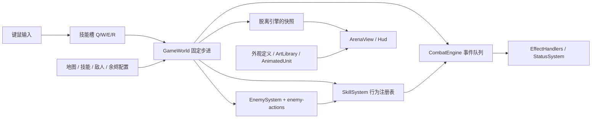

# 内容扩展架构 · 五关探索与17种敌人

当前流程（2026-10-19）：出生营地 / 休息点 / 清场余烬采用 F 交互，取消开局及逐关自动商店和奖励。扩展位置、状态与验证见 [场景指南](SCENES.md)。对外统一称“余烬”，代码保留稳定 Perk ID。

游戏源码根目录为 `EmberDemo/assets/scripts/ember/`。下面所有源码路径均相对此目录。

本文负责“新增内容具体改哪些文件”；运行机制见 [整体架构](ARCHITECTURE.md)，实施与测试流程见 [开发架构指南](DEVELOPMENT_GUIDE.md)。以下示例是供开发时注册的新内容，**并未加入当前游戏**。除特别说明外，示例对象应作为条目加入对应注册表，不要另建一份不被系统读取的配置。

新一批装备、技能、余烬使用 [统一属性契约](ATTRIBUTE_SYSTEM.md)：技能只使用总攻击力，吸血只有全能吸血；AP 为点数，急速为点数。属性由每单位 AttributeSet 解析；不要恢复旧 skillPower 百分比放大或英雄专用 deriveStats 公式。

## 攻击范围倍率

2026-10-16 起，`content/attacks.ts` 中 `ATTACK_RANGE_MULTIPLIER=2`，`scaleAttackRange(base)` 将原始设计长度转换为当前有效世界长度。新攻击配置只缩放一次：玩家普攻形式范围、技能和海克斯的 radius / range 显式调用；敌人模板在 define 中缩放普攻距离，敌方动作在 step 中统一转换 radius / innerRadius / length / width / range，action 转换施放距离与环形动作的地图边缘留白。步长、弧度、散射角、速度、伤害、冷却、单位半径、AI 守区和纯位移不乘倍率。ring 内外半径一起放大；攻击冲锋放大长度和命中宽度，玩家纯冲刺距离仍为 3.5 格。

注册表读出的是已生效数值；模拟、范围反馈、预警和属性面板直接消费，不能再乘倍率。装备 / 海克斯文案用同一转换生成范围。下方旧示例和历史设计稿的原始范围只是基数，不可当作当前有效范围。

## 扩展入口速查

敌人选目标、出招停顿、规则 / 连招与冷却配置见 [敌人行为指南](ENEMY_AI.md)，可调用 `$ember-enemy-ai`。行为注册表为 content/enemy-behaviors.ts；17种怪物已接入。

| 内容 | 必改定义 | 关联入口 | 新机制才修改 |
| --- | --- | --- | --- |
| 主动技能 | skills 的 SKILLS；描述从表达式生成 | hero 标签 → HERO_SKILLS → RewardSystem；F2 自动枚举 | SkillBehavior、SkillSystem、必要的世界状态 / 判定 |
| 装备 | equipment 的 EQUIPMENT | SHOP_CATALOG → ShopPanel；F2 自动枚举 | 属性推导 / 消费、装备槽与渲染；不决定普攻形式 |
| 敌人 | enemies 的 ENEMIES、enemy-actions 的动作/动作集 | maps.waves[].level.groups；F2枚举 | EnemySystem、CollisionWorld、MonsterVisual |
| 地图 | maps 的 MAPS | 首页和 F2 自动枚举 | 导航 / 投影模型、环境布局、阶段规则 |
| 余烬 / 海克斯 | perks 的 PERKS | RewardSystem 按技能条件过滤；F2 自动枚举 | Rule / Effect 类型、EffectHandlers、CombatHooks |
| 状态 | statuses 的 STATUSES | 技能 onHit 或余烬 effect 引用 | StatusSystem 的行为与重置语义 |
| 外观 / 动作 | appearances、animation、art-manifest 与真实资源 | ArtLibrary / AnimatedUnit / HeroSprite / EnvironmentView | 新图集布局、全新表现方式 |

注册后检查 `content/validate.ts`；新字段的语义约束需要同步加入，不能把 TypeScript 类型通过当成内容已经可玩。

## 数据、行为、表现分层



- `GameWorld` 负责时间、实体、移动、波次和系统调度，不再按 Q/W/E/R 分支执行技能，也不按敌人种类分支执行 AI。
- `content/skills.ts` 中的 `fireball`、`icebolt` 等是技能 ID。Q/W/E/R 仅是槽位，普通开局均为 `null`；输入发送 `CastSlot`，系统仅对已装备技能施法。`equippedSkills` 排除空槽，供奖励资格与冷却缩减使用。
- 技能投射物保存真实 `skillId`，命中、状态来源、余烬条件和渲染颜色都沿用它。新增投射物不会被识别为旧的 Q。
- `CombatEngine` 保留事件预算 128、链深度 6、规则去重和单次击杀保障；效果实现放在 `EffectHandlers.ts`。
- 首批 12 个海克斯已接入统一奖励池，新增出手 / 攻击特效 / 治疗 / 受伤 / 冲刺结束事件、条件限频与叠层状态。通过 `CombatHooks` 连接弹体和技能冷却，详细配置约定与数值见 [HEX_AUGMENTS.md](HEX_AUGMENTS.md)。
- 开发者模式通过版本化 `DeveloperConfig` 与 LocalTransport 单独的命令边界提供组合 / 关卡测试；面板枚举同一内容注册表。应用配置创建全新测试世界，普通世界拒绝测试动作，退出会清空测试状态；操作与扩展见 [DEVELOPER_MODE.md](DEVELOPER_MODE.md)。
- `content/validate.ts` 在启动时检查内容引用、正数参数、地图出生点、怪物配置、外观引用和奖励池容量。类型检查及测试同样覆盖这些定义。

## 添加技能

1. 在 `content/skills.ts` 添加唯一 ID、名字、冷却、标签、外观 ID 与行为参数。当前共用行为为 projectile / shield / dash / area / cone。投射物必须配置世界单位半径 `radius`；圆形范围配置 `radius`，扇形配置 `radius + arc`（弧度），共用碰撞查询。
2. 添加 `hero` 标签，即自动进入技能奖励池。`SKILL_DESCRIPTIONS` 从 expression / behavior 生成；新增行为要同步扩展格式化函数，不另写容易漂移的伤害数字。敌方技能不加 hero 标签。玩家从三选一选中技能后，确认装备到任意 Q/W/E/R 槽位；空槽直接装备，已有技能时替换，不可同时装备重复技能。
3. 添加对应逻辑测试。全新机制才需要扩展 `SkillBehavior` 与 `simulation/SkillSystem.ts` 的处理函数。

已接通的示例：

```ts
icebolt: {
  name: '霜凝弹', cooldown: 1.6,
  expression: { flat: 30, abilityPower: 0.30 }, damageType: 'magic',
  tags: ['hero', 'projectile', 'ice'], appearance: 'ice',
  behavior: {
    kind: 'projectile', damage: 30, speed: 10, range: 13, radius: 0.18,
    onHit: [{ id: 'slow', duration: 2.5, power: 0.55 }],
  },
}
```

双重施法和奥能储备通过 `hero + projectile` 标签同时支持火弹、冰弹。燃烧弹限定 `hero + projectile + fire`；冰弹不会误触发灼烧。奖励池按当前技能标签过滤无法使用的余烬；`requiresSkillTags` 表示同一技能必须匹配全部标签，`requiresSkillGroups` 表示每组标签各自至少有一个技能匹配。奥能储备要求护盾与投射物同时存在。已获得余烬不因换技能被删除，缺少触发条件时保持休眠。

当前 dash 的移动状态属于英雄，敌人调用会明确报错。若要添加冲锋敌人，应实现独立冲锋行为或先将冲刺状态扩展到各实体，不要直接把英雄 dash 配给怪物。

### 可复制示例：高速冰针

在 SKILLS 中新增下面的属性。复用现有 projectile、slow 和 ice 外观，不需要修改 GameWorld：

```ts
frostNeedle: {
  name: '霜叶冰针', cooldown: 2,
  expression: { flat: 22, abilityPower: 0.22 }, damageType: 'magic',
  tags: ['hero', 'projectile', 'ice'], appearance: 'ice',
  behavior: {
    kind: 'projectile', damage: 22, speed: 14, range: 10, radius: 0.14,
    onHit: [{ id: 'slow', duration: 1.5, power: 0.65 }],
  },
},
```

描述应展示 `22 + 0.22 AP` 魔法伤害、减速 35%、持续 1.5 秒，与 expression 一致。`power: 0.65` 表示减速后保留 65% 的原始速度，之后仍经过减速抗性与移速软阈值。SkillId、HERO_SKILLS、奖励池及 F2 技能列表会随注册表更新；投射行为的目标生命系数不能在发射时把施法者误当目标。

按以下顺序验收：F2 选择任意槽装备 → 应用关卡 → 指针朝敌人脚底施放 → 碰撞后伤害与减速生效 → 射程外 / 墙后不命中 → 换另一槽仍保留 skillId → 关闭开发者开关测试正常冷却。再检查普通奖励能够提供它、四槽不可重复，以及 double / reserve 能生效、fire 限定的 burn 不误触发。

对应测试从 `tests/simulation/content.test.ts` 的 icebolt 案例开始；不是把新技能永久绑定 Q。敌人技能也要写描述，但不加 hero 标签，不进入玩家候选。

### 全新技能行为

例如穿透弹或指定落点范围，当前配置不能完整表达。扩展 `SkillBehavior` 的区分联合 → 实现 SkillSystem.handlers → 按需扩展 SkillContext / GameWorld 状态 → 扩展引用校验 → 更新快照 / cue / 预警 → 测试实际碰撞与结束清理。当前 area 以施法者为中心，cone 立即结算，不能仅改描述就声称有鼠标落点 AOE 或前摇。

## 添加状态和联动效果

- `content/statuses.ts` 定义状态，`Actor.statuses` 保存实例；没有为每种负面状态增加专用角色字段。
- 已实现灼烧、减速和导管灼烧。减速保留各实例与时长，最强者生效，结束后较弱者可继续；韧性影响时长，减速抗性影响幅度。伤害状态按来源保存归属与跳伤节奏，导管层数与来源规则见属性实现说明，不将另一玩家的叠层、吸血或击杀转交最后施加者。
- 减速倍率作用于英雄的普通移动与敌人移动；不会改变技能冷却或冲刺距离。暂停冻结持续时间，重开 / 新波次清理英雄状态。
- `content/perks.ts` 配置触发事件、技能 / 标签条件、目标状态和效果。增加新组合通常只需增加定义，PerkId 从定义自动推导。
- 全新效果原语需要扩展 `combat-core/types.ts` 的 Effect 与 `EffectHandlers.ts`；全新状态行为需要扩展 `StatusSystem.ts`。事件队列不需要增加具体效果分支。
- 护盾通过 CombatEngine.shield 施加，保存独立来源、吸收类型与到期时间；shield / shieldTime 仅为汇总表现兼容字段，不允许直接覆盖它们实现新护盾。冰冻、击退、召唤、持续施法仍需新行为实现。

### 可复制示例：冰系命中附带更久减速

向 PERKS 数组新增一个元素，复用现有规则 / 状态处理器：

```ts
{
  id: 'coldFocus', name: '凝霜专注', color: '#A9E5F1',
  description: '冰系投射技能直接命中后，使目标减速 40%，持续 3 秒。',
  requiresSkillTags: ['hero', 'projectile', 'ice'],
  rules: [{
    event: 'OnHit', causes: ['skill'], directOnly: true,
    skillTags: ['hero', 'projectile', 'ice'],
    effect: { type: 'status', status: { id: 'slow', duration: 3, power: 0.6 } },
  }],
},
```

`requiresSkillTags` 决定是否出现于正常奖励候选，`rules.skillTags` 决定实际战斗何时触发，两者不要混淆。F2 故意不按技能过滤余烬，便于测试不满足条件时的休眠。这里新增独立减速实例；移动时取最强，实例各自过期，不把短强减速和长弱减速拼成一个长强减速。

如果添加一个全新状态 ID，要填写 STATUSES，再从技能 / effect 引用它。`interval` 是跳伤间隔，power 是每次跳伤量；只有 interval=1 时才等于每秒伤害。明确来源键、最大层数、刷新与跳伤规则，并检查多玩家归属。新 speed 状态还需定义合法倍率及控制适用性，不把所有新控制都当作 slow。

需要新效果原语时，除 `Effect / EffectHandlers` 之外，检查 `validateContent`、事件来源、波次重置、CombatHooks 的实际实现和快照表现。命中、出手、攻击特效、掉血、治疗分别使用不同事件；完整说明见 [海克斯](HEX_AUGMENTS.md)。

## 添加敌人

`ENEMIES`现在包含10小怪、5精英、2Boss，使用统一属性template与`behavior:'monster'`，`actionSet`引用`ENEMY_ACTION_SETS`。普通/精英/Boss分类和地图绑定独立于阵营；appearance使用同名程序美术ID。新同类内容的落点是定义与动作，不是在GameWorld复制update循环。

1. 在enemies添加name/template/radius/windup/recovery/category/map/actionSet/appearance，基础AS为完整普攻周期倒数。AD/AP和伤害类型分开；不增加基础/额外AD与不同种吸血。
2. 在enemy-actions添加一个attack和零到多个spell，动作集写`{attack:'...',skills:['...']}`。每段声明at/sampleAt/location/shape/expression/damageType；动作级windup/recovery/cooldown/firstDelay/range控制调度。矩形length/width、圆radius、环innerRadius/radius、扇形arc为弧度，弹体有真实radius/speed/range。多个弹体可共享maxHits去重。
3. EnemySystem调度动作、采样落点、连续扫掠冲锋/弹体、CollisionWorld查询、CombatEngine结算。攻击方向在开始锁定，不追踪玩家；分段位置按sampleAt离散采样。保留rootId/sourceId、目标计数和类型。通过validateEnemyActions验证动作与模板引用。
4. 在MonsterVisual/monster-palettes增加独立轮廓、器具与相位姿势，视图读取EnemyPose（含多段strike），不反向触发伤害。新PNG路线另按美术管线导入，不能只添加虚假appearance字符串。
5. 加入地图具体level.groups，并保证关卡spawns总表与groups一致；F2里能刷不等于正常关卡已放置。

当前动作样例可以直接在ENEMY_ACTIONS中参考：`reedThrust`窄矩形、`sunSeed`锁定落点圆、`pincerCross`错拍两扇、`mothFan`组限一次三弹、`ramLane`受阻停止冲锋、`wovenRing`真实空心环。新原语必须扩展EnemyActionShape与EnemySystem消费逻辑、CollisionWorld及预警；不能加一个从未读取的字段。

Boss配置包含threshold/loop/phase1/phase2槽表，技能表支持phase2覆盖段列表与phase2Duration。当前动作完成后跨血量阶段，转换两秒不发伤害；不重置HP。循环槽不能并发压缩前摇，未满足射程/CD/边界/可逃脱条件可以跳过。独立守区为10格唤醒（Boss12），超过18格守点或22格目标距离返回；每.55秒按模拟时刻寻路。每单位用PathfinderPool不小于自身radius的网格，Boss大体型必须有实际可通行路线。

最低验收为怪物专测、content/world/collision/hitboxes、多玩家目标与属性隔离；真实Creator构建后确认准备/出手/多段/恢复、遮挡、躲避、守区、Boss转阶段和出口。不能把改变windup999当成冻结新EnemySystem；测试定靶用显式canMove/canAttack能力，开发者freezeEnemies不等同于全局暂停。

## 添加地图与关卡

现有地图是ember 56×44、frost 60×44，各五关，仍只有两张地图。每关配置`WaveDefinition.level`：id/name/可选subtitle/start/exit（带radius）/route/groups；groups含id/center/radius/spawns。地图、关卡、营地、休息点共用 `LocationDefinition`，每处必填名称；修改注册表即可改变入场浮现标题，不能更改稳定 ID 来实现改名。完整示例见 [地点名称](SCENES.md#地点名称与入场标题)。外层spawns是该关全部敌人的汇总，用于内容校验和工具，运行放置由LevelSystem.enemyPlacements读取固定群组。hpScale当前均为1，不能暗叠旧波次倍率。

LevelSystem是纯函数入口：levelDefinition/levelSpawn决定起点与队友偏移；enemyPlacements产生确定位置与groupId；exitProgress/levelSnapshot声明出口条件。清场只激活出口，全员范围集合后房主按 F 才出发；清场倒地队友复起参与集合，已跳过的离线成员不参与。最终 Boss 击败后可选清场余烬，再到出口确认进入胜利。

新增关卡按如下顺序：

1. 配置整数尺寸、圆障碍、环境/主题和DEFAULT_LOADOUT；在content/scenes.ts的JOURNEYS中配置休息点与清场余烬。起点、出口完整容纳玩家，Boss房周边至少4.5格净空。
2. 配start/route/exit，route相邻点必须通过同一地图导航。群组避开起点安全距离，按每只敌人的实际体型检查出生可走、与障碍不重叠，并且玩家能从start接近每组再到exit；不可静默少刷。
3. `ArenaView`采用本地玩家跟随镜头而不是fit整张大图。渲染投影和InputController逆投影必须消费同一Projection；缩放/CSS/设备像素比依然经过输入适配，不用固定屏幕中心替代相机。
4. 测试五个关卡的所有路线、全部敌群/体型、出口多人集合条件、暂停/重开、恢复到正确start。开发模式跳关不会重放前关消耗，仍需正常流程验收。

地图保持静态障碍、没有动态挖路、传送、任意多边形地形或通用地牢生成器。重开保留所选地图，重置本局技能/装备/货币；地图切换只在首页。

## 装备、经济与阶段流程

- `content/equipment.ts`：装备 ID、category、固定价格、属性增量与独立被动；`SHOP_CATALOG` 自动枚举全部装备，不用维护 UI 商品分支。新装备使用已有属性与被动处理器时只需添加配置。
- `simulation/EquipmentSystem.ts`：金币、已购库存、装备槽与购买 / 换装 / 卸装。六个通用slot1..slot6不限制category。购买事务检查ID/重复/余额/目标栏后扣款，自动填空栏；满栏必须显式replaceSlot，替换者留库存。操作仅在本人互动打开的商人面板中接受；其他队友仍可在休息点移动。
- `content/progression.ts`：初始160金币，每关固定收入 `100 + (wave - 1) × 20`，清场进入cleared时仅发一次；JOURNEYS配置商人休息点。当前不卖出、不退款、不跨局保存装备或货币。
- `simulation/RewardSystem.ts`：统一 `RewardChoice` 联合类型，明确区分 perk / skill。`ChooseReward` 选余烬，技能需要 `ConfirmSkill` 确认槽位；`CancelSkill` 只撤销预选，不重新抽卡。确认后才消耗整次奖励。
- 流程为 ready → 出生 camp → fighting → cleared → 可选休息 camp / 下一关。出发均须范围集合和房主 F；shop/reward 是每玩家面板，不冻结其他玩家。最后出口确认后进入 victory。
- 装备变更替换对应 AttributeSet 来源，旧装备不会残留加成；兼容 statsView / deriveStats 只委托统一解析器。攻速按模板收益系数解析，急速采用 `100 / (100 + abilityHaste)`，百分比与急速点不能混用。
- 物理伤害走护甲，魔法伤害走魔抗；削减、穿透和负抗性按统一规则。真实组件跳过双抗，但仍受适用护盾与无敌规则。技能和护盾通过 AD/AP/生命表达式产生数值，不再有普遍 skillPower 放大。“飞弹普攻”余烬将普攻变为独立弹体，cause 为 basic 且没有 skillId；外观不决定伤害类型。生命倍率也是属性来源，快照与实际单位读取同一结果。
- 换装只更新生命上限并截断超出的当前生命，不回补生命，防止反复换装回血。第一波开始补满装备后的生命上限；其余波次仅恢复 30 点。
- 新属性扩展 AttributeSet 的字段 / 合成规则及真实消费位置；装备提供来源，不直接改技能定义。新装备槽还需扩展 EQUIPMENT_SLOTS、槽名和表现层绘制顺序。

### 六栏属性与固定人物形象

EquipmentSystem的buy(id,replaceSlot?)/equip(id,slot?)/unequip(slot)事务不按category排斥同类装备；每ID仅拥有一次。不保存外观购买顺序；装备不改变角色形象，所有六栏属性仍叠加。普攻默认为近战挥砍；形式和形态基础射程由余烬决定，与购买顺序、是否持弓杖无关。所有装备价格当前统一100；默认仅第2、4关后有商人，分别累计380、680金币，因此普通流程进入1/2/3/4/5关时最多0/0/3/3/6件，最终累计860不能用于已结束Boss。休息点可在JOURNEYS中调整。18件均已注册，暴击/全能吸血/法穿/魔抗走统一modifiers；具名被动在EquipmentEffectSystem执行。新增机制参见[装备实施指南](design/EQUIPMENT_IMPLEMENTATION.md)。

### 可复制示例：新武器类物品

在 EQUIPMENT 中增加条目：

```ts
trainingBlade: {
  name: '轻练长剑', category: 'weapon', price: 100,
  description: '攻击力 +12，技能急速 +10',
  stats: {},
  modifiers: [
    { stat: 'attackDamage', operation: 'flat', value: 12 },
    { stat: 'abilityHaste', operation: 'flat', value: 10 },
  ],
},
```

这个例子保留玩家形象与余烬决定的普攻形式；美术只需补商品图标并在ArtLibrary.icon注册。SHOP_CATALOG 和 F2 的装备选项自动更新，ShopPanel 按目录分页；属性通过装备来源进入统一解析器。若要新增普攻形式，在 BASIC_ATTACKS 注册行为，并由余烬的 basicAttack 引用其 ID，不能挂到装备上；若需要新属性，则落实解析和消费位置。

新装备优先使用 `modifiers`，可直接配置 `magicResist`、`omnivamp` 等统一字段。旧 `stats` 是现有 10 件装备的薄兼容入口；同一个属性不要同时在两处写一遍。额外攻速 / 移速通常使用 `percent`，例如 20% 写 0.2；急速 20 点使用 `flat: 20`。具名组及各操作语义按 AttributeSet 规则校验，不把所有百分比视为同一种叠加。

验收固定价格购买、余额不足 / 重复购买不扣款、替换后旧装备仍在库存、免费切回 / 卸下恢复属性、来回换装不回血、不在商店时交易被拒绝，以及装备属性对实际普攻伤害的影响、换装不改变普攻形式。新增装备也要检查既有测试中对货架数量和分页坐标的假设。

### 新装备图标

在 `ArtLibrary.icon` 的物品ID映射中注册图集与索引，生产PNG经Creator导入并维护生成来源。weapons / bodies / heads是现有商品图集分类，不是人物显示层。不要新增appearance、握点、纸娃娃或购序逻辑。新增图标检查商店、详情与装备栏，角色动画应保持同一图集与比例。

## 普攻与命中体积

- `combat-core/CollisionWorld.ts` 是独立于 Cocos 渲染 / 刚体的确定性几何查询。角色 `radius` 是脚底世界平面上的受击圆；地图障碍同样是圆。图像透明像素和装备外观不会改变碰撞尺寸。
- `HitShape` 支持circle / sector / capsule / rectangle / ring；`targets` 统一处理存活、敌我、整圆与攻击形状相交、障碍遮挡及稳定排序。扇形边缘与外圆弧都考虑目标半径，不再只检查目标中心夹角。当前范围 / 近战 / 尸爆 / 电弧搜寻都使用它。
- `firstImpact` 对弹体上一位置到下一位置执行连续圆扫掠，并考虑目标一帧内的相对移动。角色、地图障碍和边界按最早接触排序，墙与目标同时命中时墙优先；当前弹体命中一个敌人后消失。最后不足一帧的剩余射程也会检测，避免提前消失和高速穿透。
- `content/attacks.ts` 注册 `slash`（默认挥砍）与 `missile`（飞弹）形式。共同字段为 `name / range / appearance`，近战额外配置 `arc / windup / active`，远程配置 `speed / radius`。余烬通过 `basicAttack` 引用形式；CombatEngine 解析并维护单一形态射程来源，GameWorld 只按行为 kind 发射。伤害、攻速、最终射程读取单位统一属性；装备模块没有普攻解析 API。
- 默认近战为原稿实测曲面，填到脚底，无贴身盲区。`scripts/measure-melee.mjs`复现材质采样，生成`content/melee-outline.ts`；`MeleeSweep.meleeArea`与meleePoseIndex是空间 / 相位唯一入口，表现层使用相同相位和referenceRadius缩放。slash.range统一控制尺寸，windup / active控制实际时间；arc仅报告测量最大覆盖角，不用于圆形裁剪。改原图、窗口或材质后执行`node --import tsx scripts/measure-melee.mjs`并构建；测量参数和报告见[近战规格](design/BASIC_MELEE_VFX.md)。
- 新形式余烬最小配置：`{id:'missileAttack',name:'飞弹普攻',description:'…',color:'#ADC8E8',basicAttack:'missile',rules:[]}`。先在 `BASIC_ATTACKS` 注册语义 ID，再在 `PERKS` 引用；不要用 sword/bow 等物品 ID 命名行为。同种 melee/projectile 行为不需要新增 GameWorld ID 分支。
- 多个改变形式的余烬按获得顺序取最后一个，普通余烬不覆盖；不能累加多个形式的 range。统一属性仍可叠加明确的额外射程修正。通过 `CombatEngine.addPerk` 授予，禁止只向 perks Set 塞 ID 而跳过属性同步。快照 `basicAttack` 和 `action.basicAttack` 分别用于 HUD、出手动作；每玩家独立发送，v3 存档仅保存余烬 ID 并在恢复时重建。新局 / 退出 F2 回到 slash。
- 近战挥击在前摇后短暂生效，朝向在出手时固定，中心跟随角色移动；同一挥击的 `hitIds` 保证每个敌人最多命中一次，可以同时打到多个相交敌人。冲刺会取消尚未完成的挥击。近战怪物前摇时保存朝向，结束后通过同一扇形查询结算。
- 两种模式均左键攻击；右键模式只发送 MoveTo，移除 SetTarget / targetId / 自动追击。Attack 是单次出手，AttackInput 保存按住状态，松开 / 暂停 / 失焦 / 阶段切换清理。DirectInput 只负责 WASD 移动，寻路移动与按住攻击可以同时存在。
- 输入使用 screenToWorld 原始鼠标地面坐标，不再吸附敌人。弹体表现与碰撞位于同一地面平面，挥击轮廓来自实际半径 / 角度。F3 显示角色、障碍及弹体体积，缩放使用同一投影；不增加常驻复杂特效。
- 已附着的灼烧只在首次命中时检测碰撞，后续跳伤按状态计时，不重新要求视线。护盾作用自身，冲刺用已有移动扫掠。当前没有角色之间的刚体推挤、复杂多边形地形、穿透弹或高度层碰撞。

## 贴图、动画与物品图标

`content/appearances.ts` 提供单位与环境的稳定外观ID；玩家动画由animation.ts的HERO_CLIPS与wholeHeroFrame定义，图集来源生成pixel-art.ts。装备没有外观字段，UI按物品ID找图标。启动检查内容引用，测试验证切片边界。

`ArtLibrary`预加载共享透明PNG；`HeroSprite`每次显示一个完整人物帧，不分肢体、不接收装备配置。五绘制方向加三镜像覆盖八方向，战场与菜单共用。`wholeHeroFrame`为纯表现函数，不能从帧序反推移速或伤害。`MonsterVisual`按EnemyPose驱动17怪PNG，程序图形回退；AnimatedUnit保留玩家桥接与旧怪物兼容。

`GameWorld` 快照包含 `facing / action / hurtAt / diedAt`，`motionPose` 将其转换为 idle / walk / attack / cast / hurt / death。伤害、攻击间隔及冷却仍由固定步进控制，动画不回调游戏规则。暂停冻结表现时间；战斗结束时允许死亡动画播完。死亡视图短暂保留并淡出，不再参与碰撞和选择。

古树守卫现在是660HP精英，含独立三次落点技能；两Boss为庭院司炉者和霜镜执仪者，各自绑定第五关。不能把旧守卫图集放大作为Boss，也不能以仅换色宣布17种美术完成。

当前两个地图共用遗迹素材，霜镜回廊使用冷色地板与水色；环境布局为按地图尺寸适配的模板。地图障碍沿用碰撞配置，植物及瀑布主要在通行边界外。全新关卡布局可以扩展 `EnvironmentView`，不影响导航定义。旧UnitVisuals保留作参考；运行玩家/装备/环境PNG与17怪正式程序美术并用。

角色、装备、怪物、地图与特效的设计标准见 [美术风格设计指南](ART_DIRECTION.md)；资源制作规范、帧序、整身锚点、素材来源与当前限制见 [美术管线](ART_PIPELINE.md)。

## 验证

下面是可用验证入口，按 [开发指南的验证矩阵](DEVELOPMENT_GUIDE.md#验证矩阵) 选择相关项，不要求每次内容变更都执行全部长流程。

```bash
pnpm check
pnpm playthrough
# 先完成 Cocos Web Desktop 构建，并保持 pnpm play 服务运行
node --import tsx scripts/browser-playthrough.ts
pnpm test:controls
pnpm test:content
pnpm test:art
pnpm test:hitboxes
pnpm test:hexes
pnpm test:developer
pnpm test:attributes
```

浏览器脚本的旧坐标、3/2波与三类装备槽假设需要按当前版本迁移。执行前查看脚本前置条件，记录本轮真实结果；历史reports不能证明六栏/五关/新敌人已通过。单测中的直接定位出口用于阶段契约，不能冒称正常键鼠走图通关。
