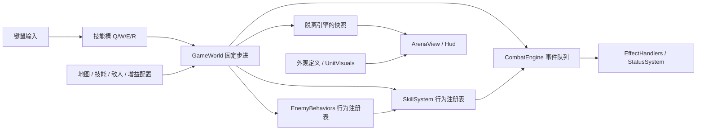

# 内容扩展架构 v0.2

游戏源码根目录为 `EmberDemo/assets/scripts/ember/`。下面所有源码路径均相对此目录。

## 数据、行为、表现分层



- `GameWorld` 负责时间、实体、移动、波次和系统调度，不再按 Q/W/E/R 分支执行技能，也不按敌人种类分支执行 AI。
- `content/skills.ts` 中的 `fireball`、`icebolt` 等是技能 ID。Q/W/E/R 仅是槽位，输入发送 `CastSlot`，系统解析当前装备。
- 投射物保存真实 `skillId`，命中、状态来源、增益条件和渲染颜色都沿用它。新增投射物不会被识别为旧的 Q。
- `CombatEngine` 保留事件预算 128、链深度 6、规则去重和单次击杀保障；效果实现放在 `EffectHandlers.ts`。
- `content/validate.ts` 在启动时检查内容引用、正数参数、地图出生点、怪物配置、外观引用和奖励池容量。类型检查及测试同样覆盖这些定义。

## 添加技能

1. 在 `content/skills.ts` 添加唯一 ID、名字、冷却、标签、外观 ID 与行为参数。当前共用行为为 projectile / shield / dash / area。
2. 若作为可选择的主技能，加入 `PRIMARY_SKILLS`；或放入地图 `loadout` 的某个槽位。当前首页提供 Q 槽切换，W/E/R 由地图装配。
3. 添加对应逻辑测试。全新机制才需要扩展 `SkillBehavior` 与 `simulation/SkillSystem.ts` 的处理函数。

已接通的示例：

```ts
icebolt: {
  name: '霜凝弹', cooldown: 1.6,
  tags: ['hero', 'projectile', 'ice'], appearance: 'ice',
  behavior: {
    kind: 'projectile', damage: 30, speed: 10, range: 13,
    onHit: [{ id: 'slow', duration: 2.5, power: 0.55 }],
  },
}
```

双重施法和奥能储备通过 `hero + projectile` 标签同时支持火弹、冰弹。燃烧弹限定 `hero + projectile + fire`；冰弹不会误触发灼烧。奖励池按装备标签过滤当前无法使用的火系增益。

当前 dash 的移动状态属于英雄，敌人调用会明确报错。若要添加冲锋敌人，应实现独立冲锋行为或先将冲刺状态扩展到各实体，不要直接把英雄 dash 配给怪物。

## 添加状态和联动效果

- `content/statuses.ts` 定义状态，`Actor.statuses` 保存实例；没有为每种负面状态增加专用角色字段。
- 已实现灼烧和减速。同种状态不相乘叠加：保留较强效果、较长剩余时间；来源跟随更强的施加者。灼烧刷新不重置下一次跳伤时间。
- 减速倍率作用于英雄的普通移动与敌人移动；不会改变技能冷却或冲刺距离。暂停冻结持续时间，重开 / 新波次清理英雄状态。
- `content/perks.ts` 配置触发事件、技能 / 标签条件、目标状态和效果。增加新组合通常只需增加定义，PerkId 从定义自动推导。
- 全新效果原语需要扩展 `combat-core/types.ts` 的 Effect 与 `EffectHandlers.ts`；全新状态行为需要扩展 `StatusSystem.ts`。事件队列不需要增加具体效果分支。
- 护盾仍使用独立的护盾数值与持续时间，尚未统一为通用状态实例。冰冻、击退、召唤、持续施法未实现。

## 添加敌人

`content/enemies.ts` 将敌人 ID 与 `behavior`、`skillId`、`appearance` 分开。

霜灯守卫 `frostling` 共用 ranged 行为，使用 frostBolt 和 frostling 外观，因此无需在 GameWorld 中为它添加判断。

- 同行为变种：加敌人定义、外观定义，然后加入地图刷怪列表。
- 新行为：扩展 `EnemyBehaviorId` 与 `ai/EnemyBehaviors.ts` 的更新函数，可复用追击 / 攻击前摇，也可实现自己的移动策略。行为通过上下文访问寻路、移动、伤害和技能施放。
- 近战与远程共用现有自动寻路，不包含行为树编辑器或复杂 Boss 阶段系统。

## 添加地图

在 `content/maps.ts` 注册地图：名字、宽高、英雄出生点、敌人出生间距、障碍、波次、初始技能和颜色主题。地图选择按钮自动枚举注册表。

寻路边界、地面绘制、出生范围、镜头居中和 HUD 总波次数全部读取同一份定义。

现有地图：

| 地图 | 尺寸 | 波次 / 敌人 | 默认 Q |
|---|---|---|---|
| 余烬庭院 | 20×20 | 3 波 / 27 个 | 烬火弹 |
| 霜镜回廊 | 24×16 | 2 波 / 13 个 | 霜凝弹 |

当前地图为整数尺寸矩形，障碍为圆形碰撞体。不支持房间串联、传送门、动态地形或程序化关卡。地图切换只在首页允许，切换会重置本局；重开保留选中的地图与技能。

奖励当前不重复领取。地图波次数必须留有足够的未拥有增益供每轮三选一，配置校验会检查容量；增加更多波次时也要扩充增益池。无法找到安全出生位置会明确报错，不会静默少刷敌人。

## 后续贴图和动画接入

`content/appearances.ts` 保存稳定外观 ID 和占位配色；`render/UnitVisuals.ts` 负责几何绘制。战斗逻辑只认实体、技能和事件，不依赖 Graphics、Sprite 或素材文件名。

目前仍为几何占位图，尚未实现 SpriteAtlas / AnimationClip 加载器。确定美术方案后，下一步是在表现层加入预制体或精灵动画视图，并保持以下约定：

- 地面脚底作为根节点锚点，沿用深度排序和独立血条，贴图大小不改变碰撞半径。
- 逻辑快照的移动速度、攻击前摇、生命和技能事件驱动动画；伤害判定继续由固定步进决定。
- 用外观 ID 关联素材清单；更换角色图片不改 AI、技能伤害或地图规则。
- 原始制作文件放仓库根目录 `art-source/`，导出资源放 `EmberDemo/assets/`，资源及 `.meta` 一起提交；体积较大的素材加入 LFS。
- 帧尺寸、朝向数量、序列帧还是骨骼动画、轮廓 / 光照风格需要在美术方案中确定，本轮没有替这些选择预设结论。

## 验证

```bash
pnpm check
pnpm playthrough
# 先完成 Cocos Web Desktop 构建，并保持 pnpm play 服务运行
node --import tsx scripts/browser-playthrough.ts
pnpm test:controls
pnpm test:content
```

`test:content` 通过真实键鼠选择第二张地图和主技能，用 WASD 模式按正常数值通关霜镜回廊，验证冰弹 / 敌方减速、两次奖励、胜利、重开和缩放后切回原地图。
