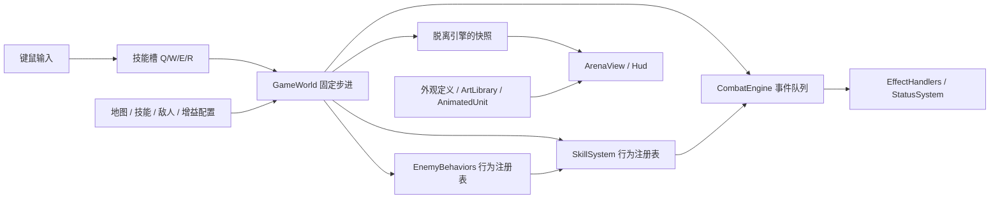

# 内容扩展架构 v0.5

游戏源码根目录为 `EmberDemo/assets/scripts/ember/`。下面所有源码路径均相对此目录。

## 数据、行为、表现分层



- `GameWorld` 负责时间、实体、移动、波次和系统调度，不再按 Q/W/E/R 分支执行技能，也不按敌人种类分支执行 AI。
- `content/skills.ts` 中的 `fireball`、`icebolt` 等是技能 ID。Q/W/E/R 仅是槽位，输入发送 `CastSlot`，系统解析当前装备。
- 技能投射物保存真实 `skillId`，命中、状态来源、增益条件和渲染颜色都沿用它。新增投射物不会被识别为旧的 Q。
- `CombatEngine` 保留事件预算 128、链深度 6、规则去重和单次击杀保障；效果实现放在 `EffectHandlers.ts`。
- 首批 12 个海克斯已接入统一奖励池，新增出手 / 攻击特效 / 治疗 / 受伤 / 冲刺结束事件、条件限频与叠层状态。通过 `CombatHooks` 连接弹体和技能冷却，详细配置约定与数值见 [HEX_AUGMENTS.md](HEX_AUGMENTS.md)。
- `content/validate.ts` 在启动时检查内容引用、正数参数、地图出生点、怪物配置、外观引用和奖励池容量。类型检查及测试同样覆盖这些定义。

## 添加技能

1. 在 `content/skills.ts` 添加唯一 ID、名字、冷却、标签、外观 ID 与行为参数。当前共用行为为 projectile / shield / dash / area / cone。投射物必须配置世界单位半径 `radius`；范围 / 扇形分别配置 `radius` 和 `arc`（弧度），共用碰撞查询。
2. 添加 `hero` 标签并在 `SKILL_DESCRIPTIONS` 写描述，即自动进入技能奖励池。敌方技能不加 hero 标签。玩家从三选一选中技能后，确认替换任意 Q/W/E/R 槽位；不可同时装备重复技能。
3. 添加对应逻辑测试。全新机制才需要扩展 `SkillBehavior` 与 `simulation/SkillSystem.ts` 的处理函数。

已接通的示例：

```ts
icebolt: {
  name: '霜凝弹', cooldown: 1.6,
  tags: ['hero', 'projectile', 'ice'], appearance: 'ice',
  behavior: {
    kind: 'projectile', damage: 30, speed: 10, range: 13, radius: 0.18,
    onHit: [{ id: 'slow', duration: 2.5, power: 0.55 }],
  },
}
```

双重施法和奥能储备通过 `hero + projectile` 标签同时支持火弹、冰弹。燃烧弹限定 `hero + projectile + fire`；冰弹不会误触发灼烧。奖励池按当前技能标签过滤无法使用的增益；`requiresSkillTags` 表示同一技能必须匹配全部标签，`requiresSkillGroups` 表示每组标签各自至少有一个技能匹配。奥能储备要求护盾与投射物同时存在。已获得增益不因换技能被删除，缺少触发条件时保持休眠。

当前 dash 的移动状态属于英雄，敌人调用会明确报错。若要添加冲锋敌人，应实现独立冲锋行为或先将冲刺状态扩展到各实体，不要直接把英雄 dash 配给怪物。

## 添加状态和联动效果

- `content/statuses.ts` 定义状态，`Actor.statuses` 保存实例；没有为每种负面状态增加专用角色字段。
- 已实现灼烧、减速和导管灼烧。灼烧 / 减速保留较强效果、较长剩余时间；导管灼烧使用 add-refresh，最多 5 层。状态刷新不重置下一次跳伤时间。
- 减速倍率作用于英雄的普通移动与敌人移动；不会改变技能冷却或冲刺距离。暂停冻结持续时间，重开 / 新波次清理英雄状态。
- `content/perks.ts` 配置触发事件、技能 / 标签条件、目标状态和效果。增加新组合通常只需增加定义，PerkId 从定义自动推导。
- 全新效果原语需要扩展 `combat-core/types.ts` 的 Effect 与 `EffectHandlers.ts`；全新状态行为需要扩展 `StatusSystem.ts`。事件队列不需要增加具体效果分支。
- 护盾仍使用独立的护盾数值与持续时间，尚未统一为通用状态实例。冰冻、击退、召唤、持续施法未实现。

## 添加敌人

`content/enemies.ts` 将敌人 ID 与 `behavior`、`skillId`、`appearance` 分开。

霜叶精灵 `frostling` 共用 ranged 行为，使用 frostBolt 和 frostling 外观，因此无需在 GameWorld 中为它添加判断。

- 同行为变种：加敌人定义、外观定义，然后加入地图刷怪列表。
- 新行为：扩展 `EnemyBehaviorId` 与 `ai/EnemyBehaviors.ts` 的更新函数，可复用追击 / 攻击前摇，也可实现自己的移动策略。行为通过上下文访问寻路、移动、伤害和技能施放。
- 近战与远程共用现有自动寻路，不包含行为树编辑器或复杂 Boss 阶段系统。

## 添加地图

在 `content/maps.ts` 注册地图：名字、宽高、英雄出生点、敌人出生间距、障碍、波次、初始技能、`shopAfterWaves`（在哪些非最终波之后开店）、环境外观 ID 和颜色主题。地图选择按钮自动枚举注册表。

寻路边界、地面绘制、出生范围、镜头居中和 HUD 总波次数全部读取同一份定义。

现有地图：

| 地图 | 尺寸 | 波次 / 敌人 | 默认 Q |
|---|---|---|---|
| 余烬庭院 | 20×20 | 3 波 / 27 个 | 烬火弹 |
| 霜镜回廊 | 24×16 | 2 波 / 13 个 | 烬火弹 |

当前地图为整数尺寸矩形，障碍为圆形碰撞体。不支持房间串联、传送门、动态地形或程序化关卡。地图切换只在首页允许，切换会重置本局；重开保留地图，但恢复统一初始技能、空装备和初始金币。

被动增益不可重复领取，技能奖励排除当前已装备技能；被替换掉的技能以后可以再次出现。正常奖励为两被动加一技能，被动耗尽时由其他技能补足三张，技能注册数量会在启动校验。无法找到安全出生位置会明确报错，不会静默少刷敌人。

## 装备、经济与阶段流程

- `content/equipment.ts`：装备 ID、槽位、固定价格、属性增量、外观 ID 和武器普攻 `attack` 配置 ID；`SHOP_CATALOG` 自动枚举全部装备，不用维护 UI 商品分支。新装备使用已有属性与外观形状时只需添加配置。
- `simulation/EquipmentSystem.ts`：金币、已购库存、装备槽与购买 / 换装 / 卸装。购买事务检查 ID、重复购买和余额后才扣款；同槽旧装备保留。所有操作仅在 GameWorld 的 shop 阶段被接受，战斗、奖励或结算阶段的购买命令无效。
- `content/progression.ts`：初始 160 金币，每波固定收入 `100 + (wave - 1) × 20`，波次完成时仅发一次；地图配置商店阶段。当前不卖出、不退款、不跨局保存装备或货币。
- `simulation/RewardSystem.ts`：统一 `RewardChoice` 联合类型，明确区分 perk / skill。`ChooseReward` 选增益，技能需要 `ConfirmSkill` 确认槽位；`CancelSkill` 只撤销预选，不重新抽卡。确认后才消耗整次奖励。
- 流程为 ready → 开局 shop → fighting → reward → 可配置的 shop → 下一波；最终 reward 后 victory。暂停只影响 fighting，商店 / 奖励自身冻结模拟时间。
- `deriveStats` 每次从基础属性和当前槽位重算，旧装备不会残留加成。平坦加值求和；同类百分比先相加，攻速和急速分别用 `基础间隔 / (1 + 加值总和)`。
- 护甲使承伤乘以 `100 / (100 + 护甲)`，之后扣护盾 / 生命；真实伤害绕过护甲但不绕过护盾。技能威力作用于英雄普通非普攻伤害和护盾生成值，`unscaled` 标记避免按普攻 / 生命 / 治疗比例派生的附伤重复放大。普攻独立读取普攻伤害、间隔和射程。长弓和法杖生成独立普攻弹体，`cause: basic` 且没有 `skillId`。法杖获得 +4 普攻射程。最终最大生命由 GameWorld 在装备统计基础上应用增益倍率，快照 stats 与角色 maxHp 保持一致。
- 换装只更新生命上限并截断超出的当前生命，不回补生命，防止反复换装回血。第一波开始补满装备后的生命上限；其余波次仅恢复 30 点。
- 新属性先扩展 `StatBonus / HeroStats / deriveStats`，再在实际消费位置应用；装备不直接改技能数据。新装备槽还需扩展 `EQUIPMENT_SLOTS`、槽名和表现层绘制顺序。

## 普攻与命中体积

- `combat-core/CollisionWorld.ts` 是独立于 Cocos 渲染 / 刚体的确定性几何查询。角色 `radius` 是脚底世界平面上的受击圆；地图障碍同样是圆。图像透明像素和装备外观不会改变碰撞尺寸。
- `HitShape` 支持 circle / sector / capsule；`targets` 统一处理存活、敌我、整圆与攻击形状相交、障碍遮挡及稳定排序。扇形边缘与外圆弧都考虑目标半径，不再只检查目标中心夹角。当前范围 / 近战 / 尸爆 / 电弧搜寻都使用它。
- `firstImpact` 对弹体上一位置到下一位置执行连续圆扫掠，并考虑目标一帧内的相对移动。角色、地图障碍和边界按最早接触排序，墙与目标同时命中时墙优先；当前弹体命中一个敌人后消失。最后不足一帧的剩余射程也会检测，避免提前消失和高速穿透。
- `content/attacks.ts` 注册空手、剑、盾、弓、法杖的普攻行为。近战配置 `arc / windup / active`，远程配置 `speed / radius`；装备的 `attack` 引用行为。伤害、攻速、射程仍由装备属性计算。新增同类武器不需要修改 GameWorld 的装备 ID 分支。
- 近战挥击在前摇后短暂生效，朝向在出手时固定，中心跟随角色移动；同一挥击的 `hitIds` 保证每个敌人最多命中一次，可以同时打到多个相交敌人。冲刺会取消尚未完成的挥击。近战怪物前摇时保存朝向，结束后通过同一扇形查询结算。
- 两种模式均左键攻击；右键模式只发送 MoveTo，移除 SetTarget / targetId / 自动追击。Attack 是单次出手，AttackInput 保存按住状态，松开 / 暂停 / 失焦 / 阶段切换清理。DirectInput 只负责 WASD 移动，寻路移动与按住攻击可以同时存在。
- 输入使用 screenToWorld 原始鼠标地面坐标，不再吸附敌人。弹体表现与碰撞位于同一地面平面，挥击轮廓来自实际半径 / 角度。F3 显示角色、障碍及弹体体积，缩放使用同一投影；不增加常驻复杂特效。
- 已附着的灼烧只在首次命中时检测碰撞，后续跳伤按状态计时，不重新要求视线。护盾作用自身，冲刺用已有移动扫掠。当前没有角色之间的刚体推挤、复杂多边形地形、穿透弹或高度层碰撞。

## 贴图、动画与装备外观

`content/appearances.ts` 使用稳定外观 ID：`UNIT_SPRITES` 配置图集、比例、色调和动作片段；`EQUIPMENT_SPRITES` 配置装备帧、尺寸和挂点；`ENVIRONMENT_APPEARANCES` 配置地图素材角色与水色。`content/art-manifest.ts` 保存真实像素区域，和 Cocos `.meta` 独立。启动检查引用，测试验证区域没有越过 PNG 边界。

`ArtLibrary` 预加载本地透明 PNG 并共享 Texture2D / SpriteFrame；`AnimatedUnit` 按外观 ID 播放怪物序列帧。`HeroRig` 使用六个中性身体部件及三个装备层，战场和商店共用；换装仅重建变化的装备组合，不更改角色实体。

`GameWorld` 快照包含 `facing / action / hurtAt / diedAt`，`motionPose` 将其转换为 idle / walk / attack / cast / hurt / death。伤害、攻击间隔及冷却仍由固定步进控制，动画不回调游戏规则。暂停冻结表现时间；战斗结束时允许死亡动画播完。死亡视图短暂保留并淡出，不再参与碰撞和选择。

古树守卫用较大的图集和独立数值，复用近战 AI；本轮只把第三波的一只普通近战替换为守卫，总敌人数仍为 27。重拳使用前摇结束后按预告方向生效的扇形体积；玩家可以通过移动到扇形之外躲避。

当前两个地图共用遗迹素材，霜镜回廊使用冷色地板与水色；环境布局为按地图尺寸适配的模板。地图障碍沿用碰撞配置，植物及瀑布主要在通行边界外。全新关卡布局可以扩展 `EnvironmentView`，不影响导航定义。旧 `UnitVisuals.ts` 保留作几何版本参考，运行时已改用贴图视图。

制作规范、帧序、换装挂点、素材来源与当前限制见 [ART_PIPELINE.md](ART_PIPELINE.md)。

## 验证

```bash
pnpm check
pnpm playthrough
# 先完成 Cocos Web Desktop 构建，并保持 pnpm play 服务运行
node --import tsx scripts/browser-playthrough.ts
pnpm test:controls
pnpm test:content
pnpm test:art
pnpm test:hitboxes
pnpm test:hexes
```

`test:content` 使用种子 16、真实键鼠和正常数值通关霜镜回廊，覆盖开局商店、跨页购买、余额不足、技能奖励 / 取消 / E 槽替换、波间收入、购弓、换装、卸下、外观预览、缩放、双向减速和重开清空本局。奖励池扩充后更新种子，继续从正常抽取获得冰弹。
