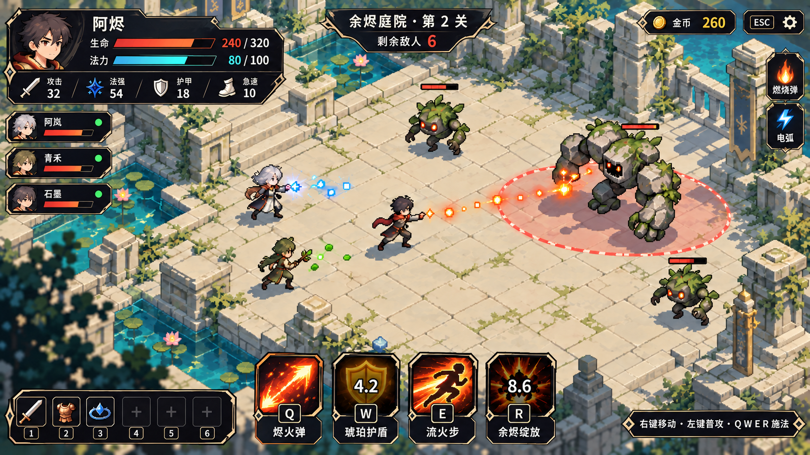
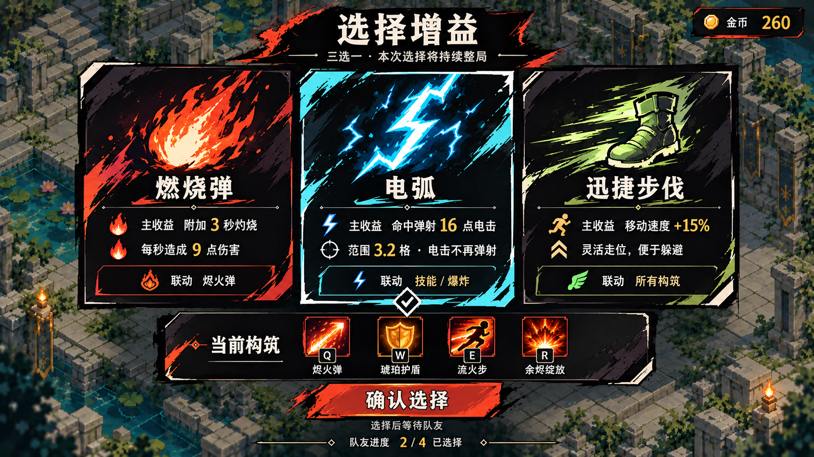
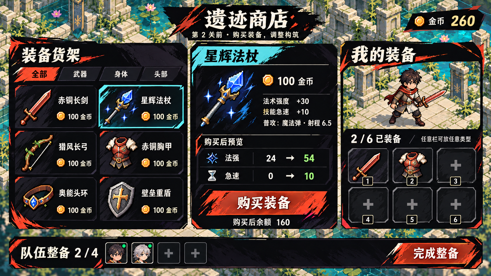
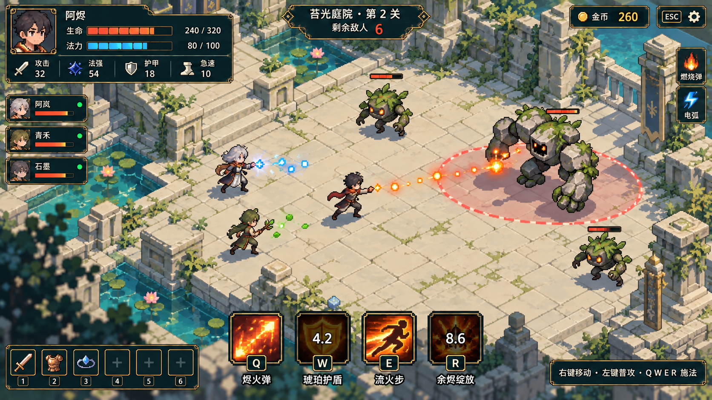
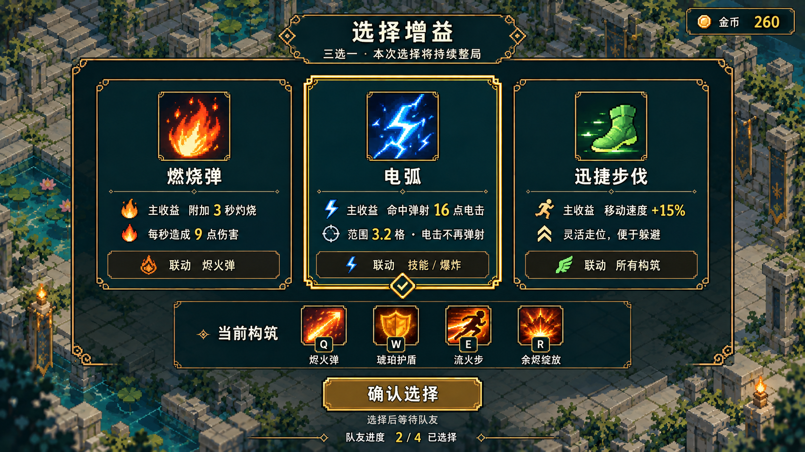
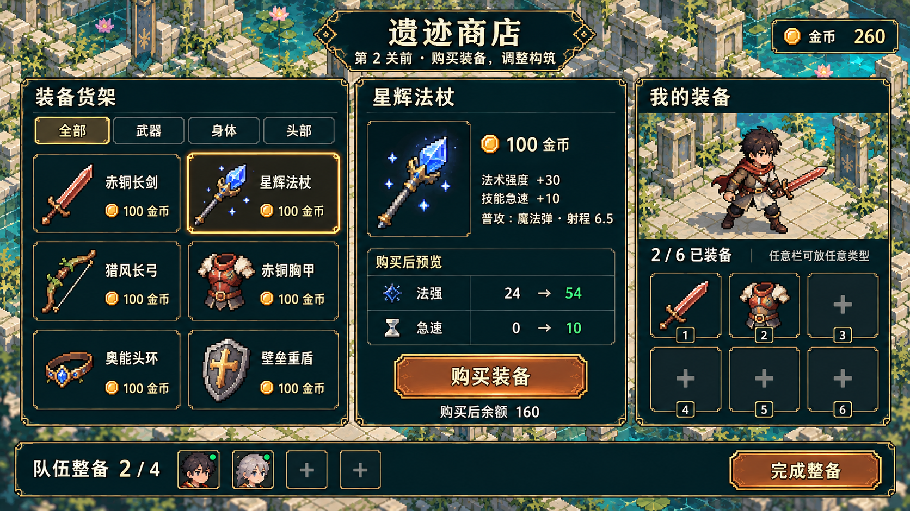
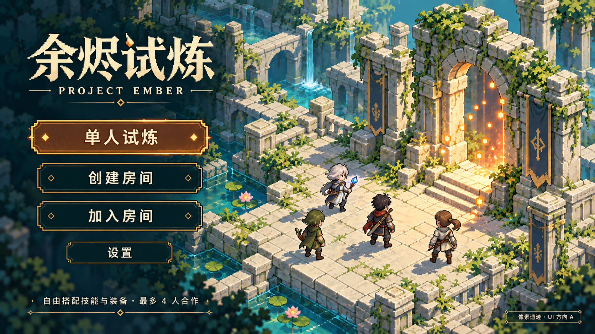
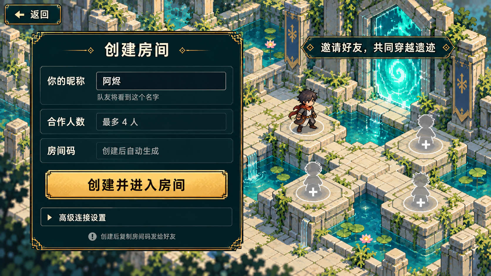
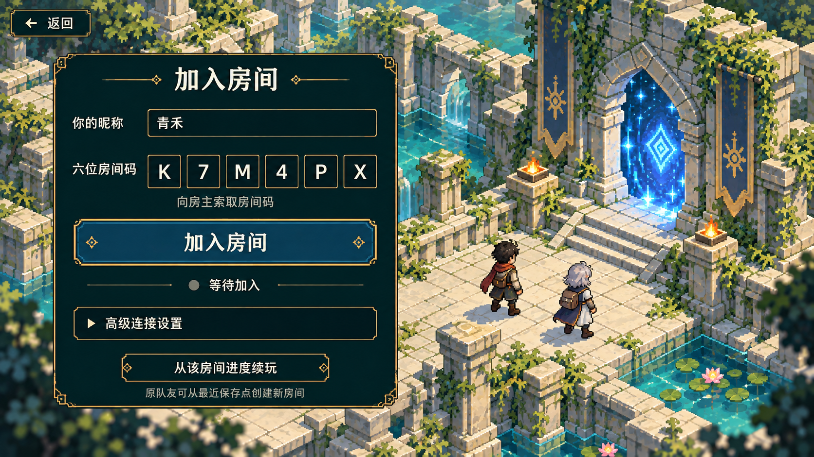
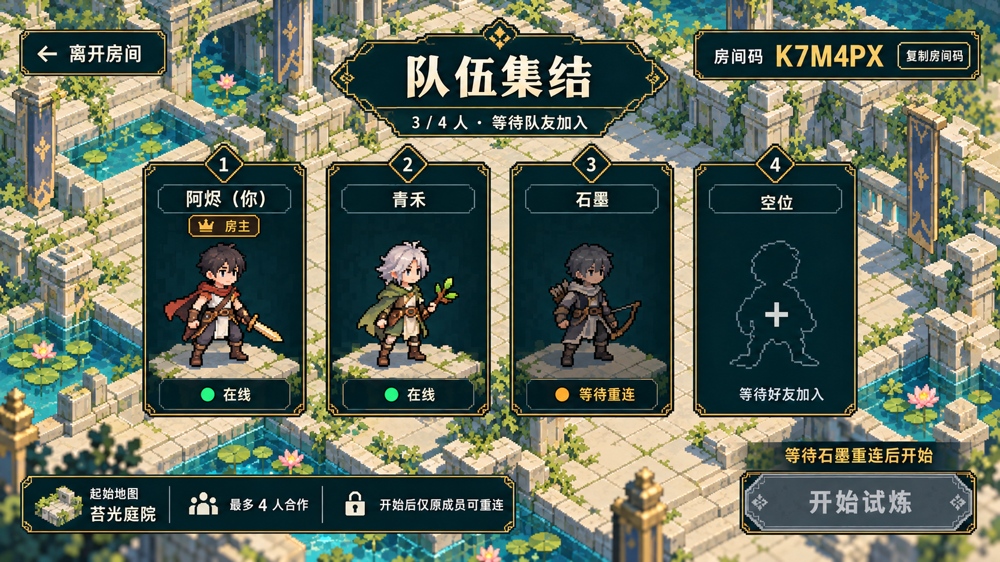

# UI 布局与视觉候选

2026-10-16 反馈：用户认可初版的总体布局，认为视觉偏老土，希望参考《哈迪斯》。后续候选保留信息分区、操作流程与像素遗迹世界，重新设计 UI 的图形语言；不将这次 UI 调整解释为取消像素世界方向，也不表示新视觉已经定稿或接入游戏。

## 候选 B：锐利的神话动作风

参考 [Hades 官方游戏页](https://www.supergiantgames.com/games/hades/) 的视觉方向，使用项目自身的角色、图标与命名。本轮优先比较战斗 HUD、增益选择与商店三张代表界面。

| 维度 | 本轮设计目标 |
| --- | --- |
| 面板 | 炭黑 / 墨紫的大色块、斜切或不对称边缘；精简包围每项信息的细框 |
| 文字 | 骨白正文、醒目的标题和数值、清楚的大小层级；中文保持易读 |
| 强调 | 朱砂 / 橙红表现选中和主要操作，冰青或绿作为功能强调；金属色只用于少量节点 |
| 图标 | 有力轮廓、版画感与硬边色阶，减少宝石镶嵌和浮雕装饰 |
| 保留 | 既有信息分区、三选一卡、商店三栏、QWER 四技能与六个通用装备栏；场景维持像素遗迹 |
| 制作边界 | UI 面板和字体可用清晰的高分辨率绘制，不把世界贴图的源像素网格机械套在所有界面元素上；世界资产仍按 ART_DIRECTION 制作 |

### 战斗 HUD · 精炼版

保留总体布局与明亮像素场景；黑曜石面板采用克制的骨白 / 浅金切边，生命和法力承担主要强调色。精炼版收掉了首轮过密的红色抓痕与头像火边，四技能、六格装备、属性和队友信息保持。

### 增益选择 · 版画表现

三张卡按火色、冰青、浅绿建立清楚的图形差异；选中使用切角、色块与勾选。此页仍保留较强笔触，是阶段菜单表现的候选强度，不把所有纹理照搬到战斗 HUD。

### 商店 · 版画表现

保留货架、属性对比、角色与六格装备三栏；标题和购买按钮采用更有力度的平面图形。首轮菜单笔触偏强，后续可以沿精炼 HUD 的边线继续统一。

三张代表界面和一张 HUD 首轮对照均已保存。来源、完整 Prompt 与已知文字瑕疵见 [候选 B 制作记录](../art-source/ui-hades-v2/README.md)。本轮只探索三种主要场景的视觉，首页及创建 / 加入 / 等待房间仍保留下面的 A 版样张，没有声称它们已经完成新版视觉。

这是视觉探索，技能数值、蓝条启用和大厅交互的实施边界仍见文末；已认可的总体布局也需要实际窗口适配与交互验证。

## 初版 A：历史对照

本页是 2026-10-16 的 UI 方向讨论稿。用户已确定后续美术改用像素风；**本组界面布局、按钮形态和色值是待评审候选，未表示用户已选定，也未接入游戏**。七张图分别覆盖完整屏幕，采用同一视觉语言，便于判断风格一致性与信息层级。

设计视口目标为 1280×720，生成 PNG 实测均为 1672×941，比例约 16:9。它们是完整屏幕效果图，不是可直接切入引擎的精确排版稿或图集。

## 候选视觉语言

深青 `#17343A` 面板、象牙 `#F0E6CD` 字、克制的铜金 `#BC965A` 阶梯细边；生命用火色、法力用冰蓝，连接成功辅以苔绿。颜色之外保留图标、数值和状态文字。按钮以直角 / 阶梯轮廓为主，选中态使用细边与勾选，避免依靠大光晕。

世界背景延续等距浅石自然遗迹，人物保持中性，通过可换装装备表达构筑，不锁定职业。中文字体优先清楚可读，无需强求所有小字像素化。生产要求仍以 [美术风格](ART_DIRECTION.md)、[像素特效](PIXEL_VFX.md) 与 [美术管线](ART_PIPELINE.md) 为准；生成图中的装饰细节、景深和发光不是额外获批标准。

## 1. 战斗 HUD

左上集中自己的 HP、MP 与攻击 / 法强 / 护甲 / 急速；左侧短队友列表，顶部关卡与剩余敌人，右侧增益。底部 QWER 大图标、剩余 CD 和技能名同时显示，六个通用装备栏独立收在左下。主战斗中心与危险椭圆保持开敞。最终版已将药水 / 材料占位改成装备及空位。

实际技能名应为 **烬火弹、琥珀护盾、流火步、余烬绽放**。装备为六个不限类型的属性栏，不是固定武器 / 防具 / 消耗品栏。图中的 240 / 320 HP、80 / 100 MP、属性、金币与 CD 全为排版样例。

## 2. 选择增益

三张并排卡方便比较主收益、补充说明与联动，底部保留当前技能与队伍确认进度。示例使用真实增益 **燃烧弹、电弧、迅捷步伐**，选中和确认分开表达。

此屏只展示三个被动卡的排版，**不改变当前正常奖励尽量提供两个被动 + 一个未装备主动技能的规则**。后续需补主动技能候选、完整效果详情、选择后替换 QWER 槽位及队友等待状态。未设计收费刷新或擅自取消当前奖励规则。

## 3. 商店

左侧六件目录商品，中间详情与购买前后属性，右侧角色预览和六个通用装备栏；底部完成整备。示例商品为 **赤铜长剑、星辉法杖、猎风长弓、赤铜胸甲、奥能头环、壁垒重盾**。商品价格与属性取当前配置作阅读样例；不作为本次玩法修改。选中星辉法杖显示法强 24 → 54、急速 0 → 10，余额 260 → 160。

后续实现需补满栏替换、金币不足、跨页目录、完整独立被动说明、购买失败和等待队友等状态。保持 `slot1–slot6` 通用栏及购买顺序解析外观 / 普攻的规则。

## 4. 首页

保留单人、创建、加入和设置四个清楚入口，以浅石、水与少量方形火花建立像素遗迹氛围。不同角色的装备只表达构筑，不代表固定职业。

## 5. 创建房间

昵称是主要输入，说明最多四人，创建后生成房间码；高级连接折叠。连接地址等技术字段不进入主要流程。人数行是说明，不表示已支持可配置房间容量。

## 6. 加入房间

昵称与六位房间码是主要输入，示例 `K7M4PX`。分格是视觉提案，实际输入仍需支持一次粘贴完整码。保留“从该房间进度续玩”，其含义是原队友从最近保存点建立新房间，恢复后产生新码；不承诺战斗逐帧恢复。

## 7. 房间内组队等待

四张成员卡并列，房主带皇冠和文字；区分在线、等待重连、空位。房间码与复制按钮明显，开始按钮旁说明当前等待原因。本图用“等待石墨重连”及禁用开始示范状态反馈，没有新增大厅准备确认协议。

## 实施边界与已知瑕疵

| 项目 | 当前能力 / 后续需做 |
| --- | --- |
| 蓝条 | 底层已有 `mana / maxMana / manaCost`；当前玩家模板 `resourceKind:'none'`，没有玩家初始法力上限，现有技能没有配置耗蓝。蓝条是用户要求的 UI 提案；启用玩家法力、上限、恢复与技能耗蓝需要后续玩法配置和接入，不能宣传当前已有玩家蓝耗玩法。 |
| 队伍整备 / 奖励确认 | 当前支持多人 shop / reward 阶段各自确认；图中队友进度为布局建议。 |
| 大厅与重连 | 已有房主开始、复制房间码、成员在线 / 离线与续玩能力；独立四卡大厅、等待重连禁用开始的具体条件属于候选交互，需要与现有协议协调。没有声称新增 ready、地图投票、匹配或聊天。 |
| 页面结构 | 当前 RoomPanel 是浏览器房间面板，本组创建 / 加入 / 等待为全屏拆分提案；首页和商店排版等均未实现。 |
| 地图名 | 生成图误用了“苔光庭院”，当前实际名称为 **余烬庭院**。制作记录保留原始提示词，实施按实际配置取名。 |
| 图中文字 | 少量“烬 / 绽 / 垒”等字形存在生成变体，首页右下角候选标记也有瑕疵；主操作中文可读。生产时使用真实字体与配置文案重排，不能以位图文字作为最终 UI。 |
| 像素一致性 | 背景局部有景深模糊、较密装饰和发光边，部分图标密度不同。它们仅表达氛围，生产资产按 ART_DIRECTION 的硬边、色阶、像素网格和战场细节预算重制。 |
| 未覆盖状态 | 低生命、缺蓝、CD 就绪提示、技能替换、满装备、金币不足、错误房间码、连接失败、加载与重连完成等，后续设计 / 实现需补齐。 |

本次只交付候选设计。已完成七图目视审查、PNG 头 / 尺寸检查和文档相对链接检查；没有修改游戏源码 / 运行时资源，没有执行 Cocos 构建或玩法测试，不把静态效果图检查等同于实机可用性验收。完整来源及最终 Prompt 见 [制作记录](../art-source/ui-pixel-v1/prompts.md)。

